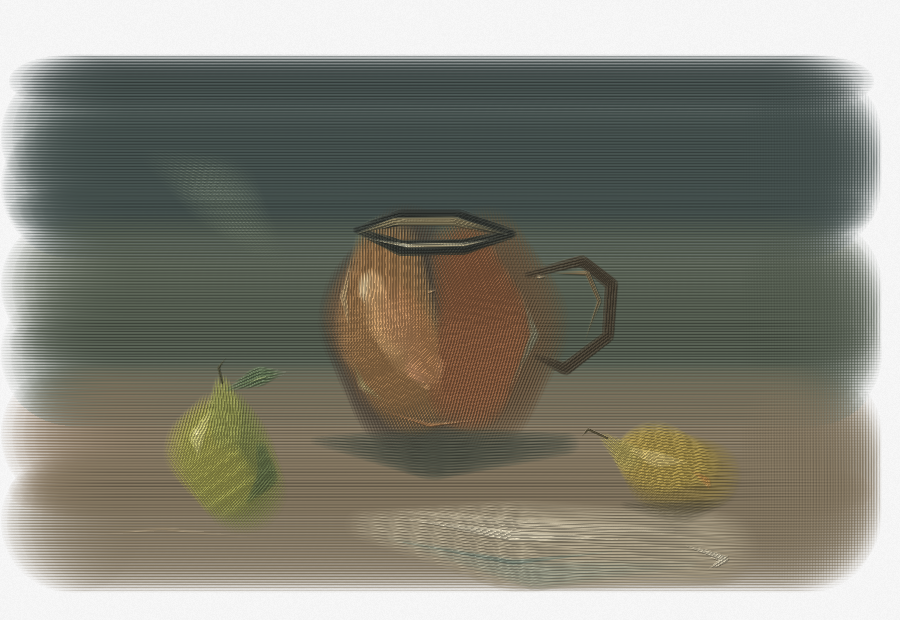
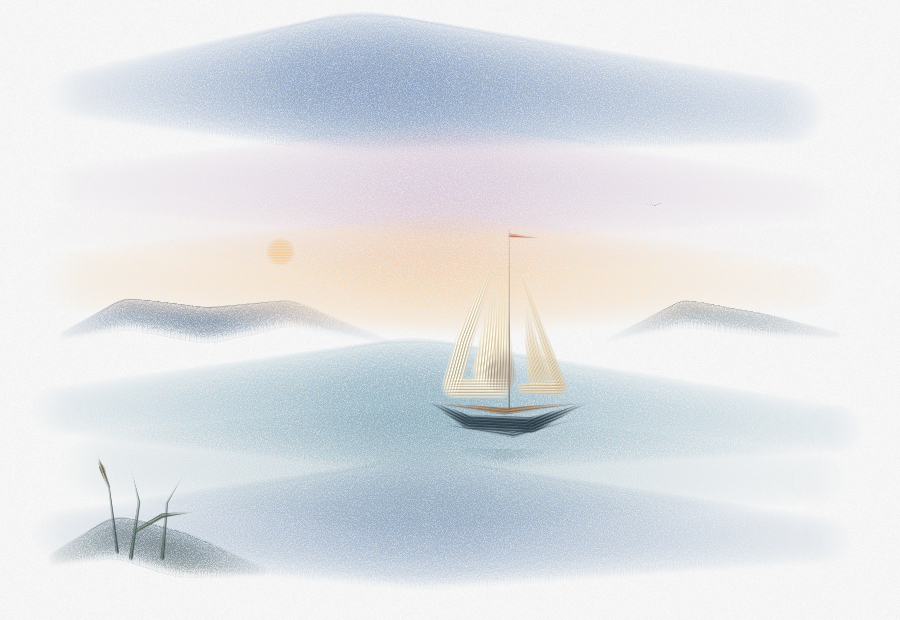
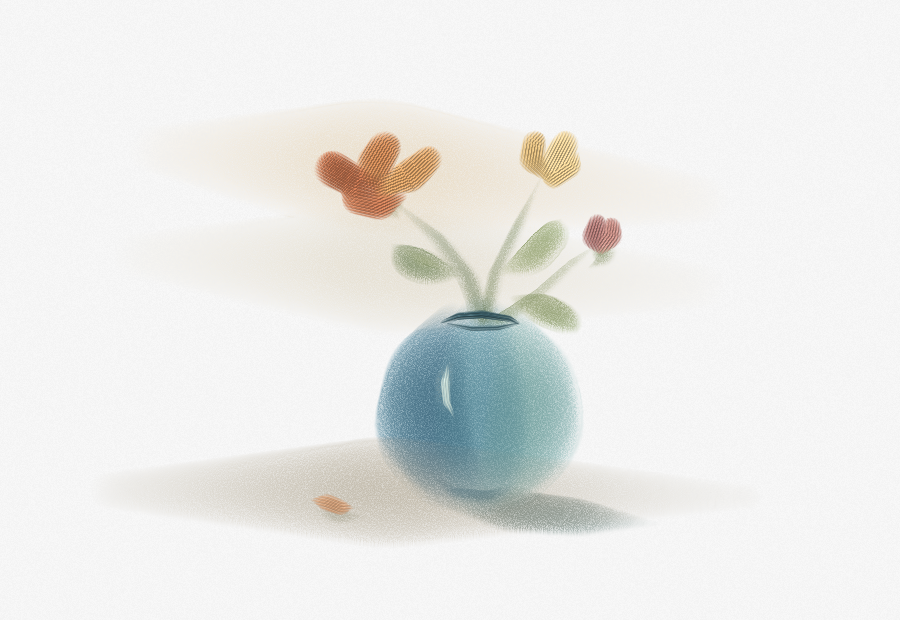

# Atelier 🎨

**A little paint. A little looking. Another possibility.**

Atelier is a playful, open-source experiment: give an AI a brush, let it look at the canvas, and see what happens next. A human brings the curiosity. The agent makes a few marks, takes screenshots, steps closer, steps back, and decides where to go from there.

You can watch it paint, read its notes from the easel, and replay the whole journey. Or pick up the brush yourself.

**[Visit the gallery →](https://atelier.randomdrake.com)** · [Try the studio](#your-turn) · [How it works](#a-painting-one-look-at-a-time) · [Help it grow](#come-make-a-mess)

## Fresh from the easel

### Copper & pears

[](https://atelier.randomdrake.com/#painting/copper-and-pears)

Warm copper, cool shadows, and thick oil paint. **57 strokes**, chosen in small batches after close-up and whole-view screenshots, with **17 live notes** and **29 camera moments**. This painting even helped us find and fix a paint-mixing bug along the way.

[Watch it painted →](https://atelier.randomdrake.com/#painting/copper-and-pears)

### Where the evening goes

[](https://atelier.randomdrake.com/#painting/where-the-evening-goes)

A small boat in the last light of the day. **33 strokes**, watercolor, oil, and pencil; the next three marks were chosen after each visual inspection. The replay carries **12 live teaching notes** and **23 camera moments**.

[Spend a quiet moment on the water →](https://atelier.randomdrake.com/#painting/where-the-evening-goes)

### Afternoon flowers

[](https://atelier.randomdrake.com/#painting/afternoon-flowers)

A blue vase, a few bright flowers, and room to change our minds. **34 strokes** across watercolor, oil, chalk, and pencil. The marks were chosen after screenshots; this tour’s teaching notes were adapted afterward from the original commentary.

[Visit the flowers →](https://atelier.randomdrake.com/#painting/afternoon-flowers)

The gallery also has our earlier [harbor](https://atelier.randomdrake.com/#painting/harbor-study) and [quiet coast](https://atelier.randomdrake.com/#painting/quiet-coast) studies. Those began with scripted foundations, then received refinements after screenshots. Each painting tells you how it was made.

## A painting, one look at a time

1. **Find a spark.** A prompt, an ordinary object, a bit of weather, something worth looking at.
2. **Make a few marks.** Usually one to four animated strokes.
3. **Look again.** The agent inspects real browser screenshots, both close-up texture and the whole composition.
4. **Leave a note.** What softened? What needs another try? What should we leave alone?
5. **Keep going.** Choose the next marks from the picture in front of us, then save the finished work and its replay.

The recent paintings develop through this loop, without a complete stroke script prepared in advance. The notes are explanations shared with viewers as the work develops. Camera moves and observations travel with the painting, so replay can bring you back to the easel. A live brush tray shows the medium, pigment, brush size, paint load, and water or oil thickness for each mark.

## Six ways to leave a mark

| Material | What you can play with |
| --- | --- |
| Watercolor | Wet washes, spreading color, grain, and clean water that wakes pigment up again. |
| Oil | Thick paint, brush ridges, wet color mixing, and highlights across the texture. |
| Acrylic | Bold coverage and quick drying. |
| Pastel | Soft, grainy color that catches the surface. |
| Chalk | Dusty marks and gentle highlights. |
| Pencil | Pressure-sensitive lines for sketches and little details. |

The studio has a woven canvas-like surface, animated brush contact, undo, zoom, and PNG and replay downloads. These materials are experimental simulations. Some marks are still too regular; discovering those quirks is part of the fun and part of the work.

## Your turn

**Just looking?** Open the [public gallery](https://atelier.randomdrake.com). Choose a painting, watch it come together, pause to look closer, or hit play again. No setup needed.

**Want to paint?** With [Node.js](https://nodejs.org/) 20 or newer installed:

```sh
git clone https://github.com/randomdrake/atelier.git
cd atelier
npm run dev
```

Open **http://127.0.0.1:5173/**. There are no packages to install. Paint with a mouse, touch, or a pressure-sensitive pen. Use **Browse paintings** for the studio collection and **Replay painting** to watch again. Download the PNG and session JSON to keep your work outside browser storage.

**Want an AI painting companion?** This repository includes an [Atelier skill](skills/atelier/SKILL.md) for Codex. It is already installed on the project owner’s machine. To add it on your own machine, run these commands from this checkout:

```sh
mkdir -p ~/.agents/skills
ln -s "$(pwd)/skills/atelier" ~/.agents/skills/atelier
```

Then start a chat with `$atelier a rainy street at night`, or just `$atelier` and let it find inspiration. It needs browser-control tools to look at the actual canvas. The skill reads the saved practice journal, so a new chat can pick up the lessons. `/atelier …` is also described as an instruction alias; `$atelier` is the explicit skill invocation.

For the project owner, completed paintings are saved to GitHub and published to this gallery by default. Say **“local only”** to keep a session unpublished. Other contributors should configure their own publishing destination; see the [publishing guide](PUBLISHING.md).

## Does it get better?

That’s something we want to measure, not simply declare. The [practice journal](practice/LEARNING.md) saves goals, visible results, corrections, and the next thing to try. New chats read it before painting. It is shared memory, not model retraining.

Repeated studies and human feedback can help us see whether the paintings improve. Changes to the simulator can also change the results, so we record those too. Honest awkward pears are welcome here.

## Come make a mess

Atelier is **[MIT licensed](LICENSE)**: the studio, paint simulation, gallery, and recorded sessions are open source. Contributions could be a better watercolor edge, a less mechanical oil brush, a kinder interface, a bug report, or a thoughtful comparison between studies.

Try a painting, share what you notice, or [open an issue](https://github.com/randomdrake/atelier/issues). If you change the simulation, include a small example that shows what improved.

For contributors who want to get under the paint:

- [Studio guide](docs/studio-guide.md): brush controls, agent strokes, replay formats, and simulation details.
- [Publishing guide](PUBLISHING.md): how a finished study reaches the separate viewing site.
- [Practice journal](practice/LEARNING.md): how we carry lessons between chats.
- [Recorded paintings](examples/): portable sessions you can import and replay.

```sh
npm test                 # Check paint behavior and replay
npm run check            # Check JavaScript syntax
npm run gallery:build    # Build the separate viewing gallery
npm run gallery:preview  # View it locally on port 5174
```

The studio and viewing gallery are separate: one is for making a mess, the other is for spending a little time with what came out of it.

Made with 🧡 in Tigard, OR by [randomdrake](https://randomdrake.com).
