# Atelier 🎨

**A little paint. A little looking. Another possibility.**

Atelier is a playful, open-source experiment: give an AI a brush, let it look at the canvas, and see what happens next. A human brings the curiosity. The agent makes a few marks, takes screenshots, steps closer, steps back, and decides where to go from there.

You can watch it paint, read its notes from the easel, and replay the whole journey. Or pick up the brush yourself.

**[Visit the gallery →](https://atelier.randomdrake.com)** · [Try the studio](#your-turn) · [How it works](#a-painting-one-look-at-a-time) · [Help it grow](#come-make-a-mess)

## Fresh from the easel

### A berry before winter

[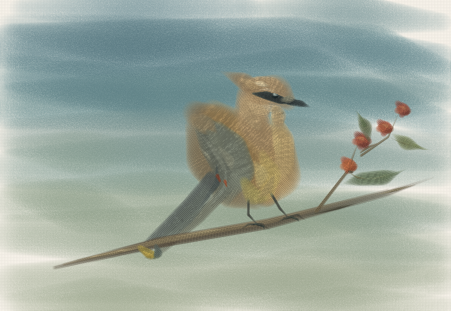](https://atelier.randomdrake.com/#painting/a-berry-before-winter)

An original bird study in **112 animated marks**, developed through **29 settled paired inspections**, upper and lower reviews and deliberate final refinement. Broad overlaps kept the body filled and crossing passes filled the berries. Warm belly, grey wing and a compact crown light hold focus; a loaded eye glint survives. Faceted crown, bracket feet, throat notch and raised joins remain. Inspired by the [NPS bird guide](https://home.nps.gov/dino/learn/nature/birds.htm). The broadcast ended with all112 marks acknowledged.

[Watch the waxwing study unfold →](https://atelier.randomdrake.com/#painting/a-berry-before-winter)

### Three petals for the shade

[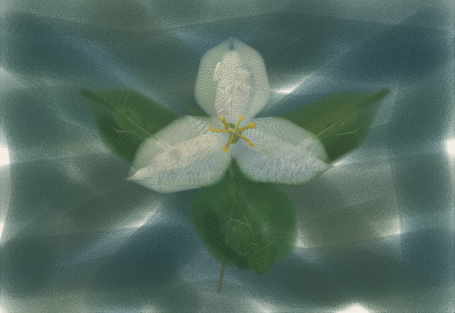](https://atelier.randomdrake.com/#painting/three-petals-for-the-shade)

An original forest study in **112 animated marks**, developed through **29 settled paired inspections**, upper and lower reviews and deliberate final refinement. Broad overlaps kept petals filled and closed the lower leaf slit; warm/cool planes and a short shoulder accent hold focus. Misplaced veins were mostly covered while relief remains. Faceted crown, stiff center and raised joins retained. Inspired by [Mount Rainier’s white forest wildflowers](https://www.nps.gov/mora/learn/nature/forest-wildflowers-white.htm). The broadcast ended with all 112 marks acknowledged.

[Watch the trillium study unfold →](https://atelier.randomdrake.com/#painting/three-petals-for-the-shade)

### Hearts held above the shade

[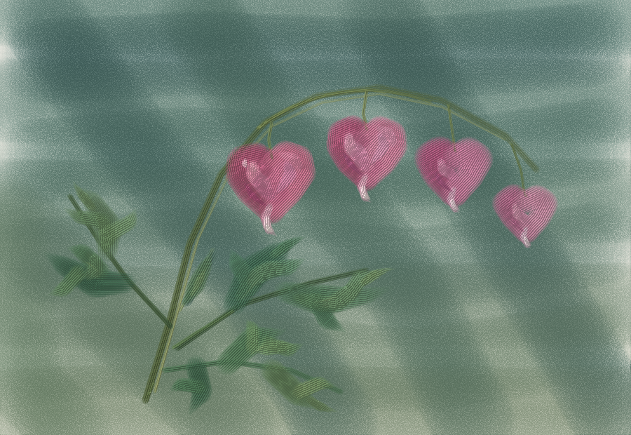](https://atelier.randomdrake.com/#painting/hearts-held-above-the-shade)

An original botanical study in **112 animated marks**, developed through **29 paired inspections**, upper and lower focus reviews and deliberate final refinement. Broad overlaps closed flower holes before pale tips; a compact shoulder light holds focus. A misplaced stem rail became a narrow leaflet. Faceted arch, stylized hearts and raised leaf joins remain. Inspired by [Mount Rainier’s forest wildflowers](https://www.nps.gov/mora/learn/nature/forest-wildflowers-red.htm). The broadcast ended with all 112 marks acknowledged.

[Watch the bleeding-heart study unfold →](https://atelier.randomdrake.com/#painting/hearts-held-above-the-shade)

### A red roof for rain

[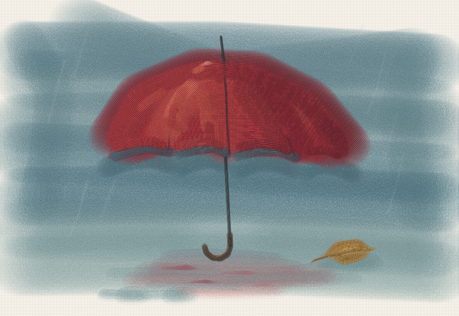](https://atelier.randomdrake.com/#painting/a-red-roof-for-rain)

An original study in **112 animated marks**, developed through **29 paired inspection boundaries**, upper and lower focus reviews and deliberate final refinement. Broad overlaps joined the canopy before sparse ribs; red neighbors shortened mixed dark scallop bars, and a restored compact crown light holds focus. Raised joins, angular ribs and faint rain remain. The eight-mark inspection had partial framing; later pairs used corrected canvas crops. Inspired by the [Smithsonian umbrella collection](https://americanhistory.si.edu/collections/object/nmah_368171). The broadcast ended with all112 marks acknowledged.

[Watch the umbrella study unfold →](https://atelier.randomdrake.com/#painting/a-red-roof-for-rain)

### Violet resting on ochre

[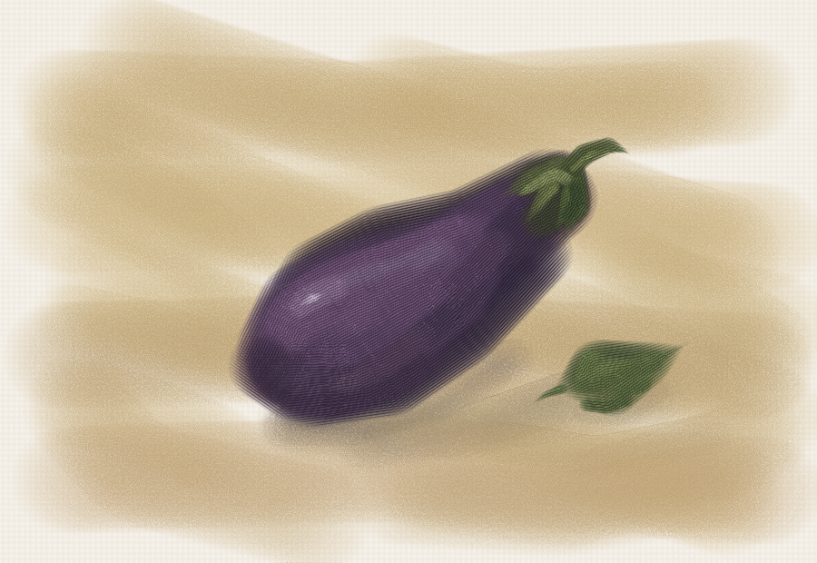](https://atelier.randomdrake.com/#painting/violet-resting-on-ochre)

An original still life in **80 animated marks**, developed through **21 settled paired inspections**, upper and lower reviews and deliberate final refinement. Broad curved overlaps kept the body continuous; one compact reflection holds the focus. Later lower-curve repairs changed the outline slightly but retained raised joins. Inspired by [NC State’s eggplant reference](https://plants.ces.ncsu.edu/plants/solanum-melongena/common-name/eggplant/). The broadcast ended with all 80 marks acknowledged.

[Watch the aubergine study unfold →](https://atelier.randomdrake.com/#painting/violet-resting-on-ochre)

### Blue thread, warm wood

[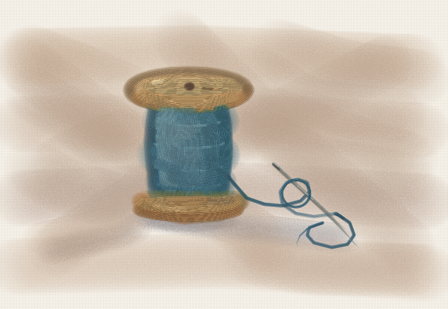](https://atelier.randomdrake.com/#painting/blue-thread-warm-wood)

An original still life in **80 animated marks**, developed through **21 settled paired inspections**, upper and lower reviews and deliberate final refinement. Broad overlaps closed the cylinder before thin thread; blue neighbors shortened winding rails. A sampled loop became rounder but gained a second strand. Raised joins, a notched rim and far loop facets remain. Inspired by the [Smithsonian spool collection](https://americanhistory.si.edu/collections/object/nmah_1093975). The broadcast ended with all 80 marks acknowledged. Stopped because further covers added relief with little form improvement.

[Watch the spool study unfold →](https://atelier.randomdrake.com/#painting/blue-thread-warm-wood)

### A key for the quiet room

[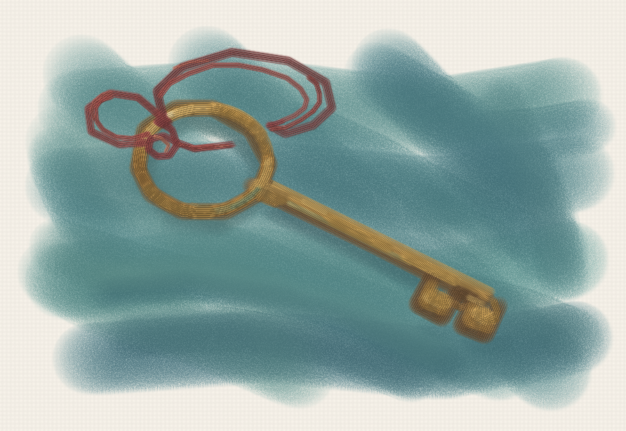](https://atelier.randomdrake.com/#painting/a-key-for-the-quiet-room)

An original still life in **88 animated marks**, developed through **23 settled paired inspections**, upper and lower reviews and deliberate final refinement. Broad crossing washes quieted cloth gaps; warm filled teeth and a compact bow glint hold focus. Sampled repairs partly eased the bow but added cord strands; raised shaft joins and regular bristles remain. Inspired by the [Smithsonian key collection](https://asia.si.edu/explore-art-culture/collections/search/edanmdm%3Afsg_FSC-M-81a-h/). The broadcast ended with all88 marks acknowledged.

[Watch the key study unfold →](https://atelier.randomdrake.com/#painting/a-key-for-the-quiet-room)

### Paper skins, violet shadows

[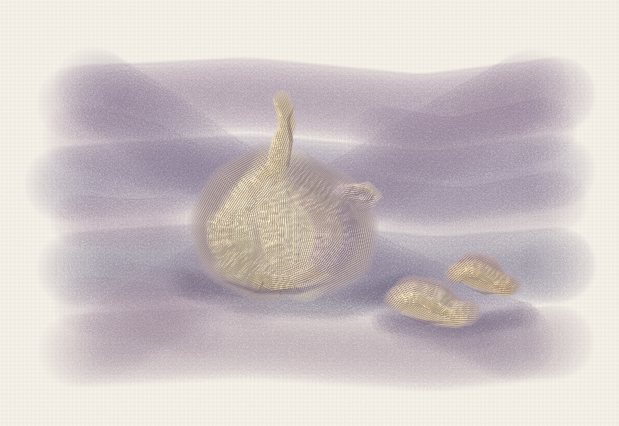](https://atelier.randomdrake.com/#painting/paper-skins-violet-shadows)

An ivory garlic bulb and two unequal cloves in **88 animated marks**, developed through **23 whole-and-close inspection boundaries**. Broad overlaps closed the bulb and filled the cloves before fine skin and roots. Pale neighbors quieted a dark seam; raised repairs and regular bristles remain. Live notes and camera moments travel with the replay.

[Watch the garlic study unfold →](https://atelier.randomdrake.com/#painting/paper-skins-violet-shadows)

### A rattle above the river

[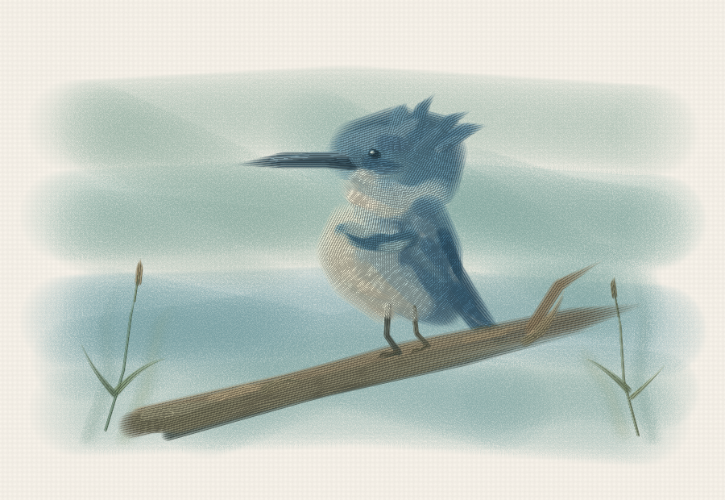](https://atelier.randomdrake.com/#painting/a-rattle-above-the-river)

An original bird study in **112 animated marks**, developed through **29 settled paired inspection boundaries**, upper and lower camera reviews and deliberate final refinement. Broad body and collar planes preceded details; blue neighbors broke a pale wing rail and warm overlaps joined the perch underside. A compact eye light holds the gaze; angular legs and raised repairs remain. Inspired by the [NPS river guide](https://home.nps.gov/miss/learn/nature/birdsking.htm). The broadcast ended with all 112 marks acknowledged.

[Watch the kingfisher study unfold →](https://atelier.randomdrake.com/#painting/a-rattle-above-the-river)

### What the oak leaves behind

[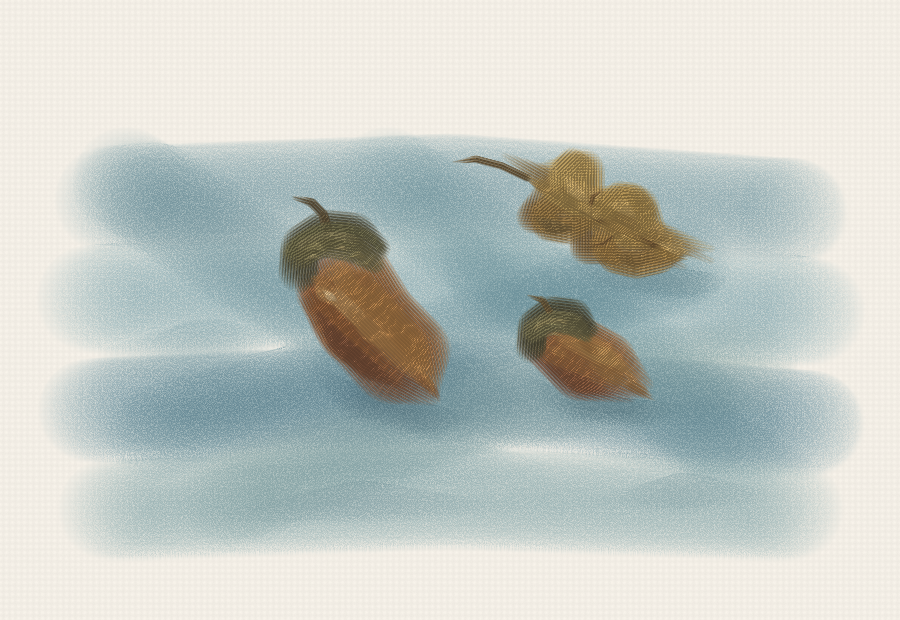](https://atelier.randomdrake.com/#painting/what-the-oak-leaves-behind)

An original still life in **88 animated marks**, developed through **23 settled paired inspections**, upper and lower reviews, and deliberate final refinement. Broad diagonal overlaps closed gaps; warm neighbors broke a rigid leaf vein while retaining raised seams. A compact shoulder light holds focus. Inspired by the [Minnesota DNR seed story](https://www.dnr.state.mn.us/forestry/education/seeds/storyofseed.html). The broadcast ended with all88 marks acknowledged.

[Watch the acorn study unfold →](https://atelier.randomdrake.com/#painting/what-the-oak-leaves-behind)

### Purple keeps the afternoon

[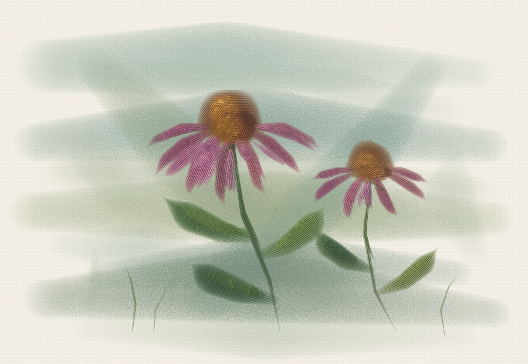](https://atelier.randomdrake.com/#painting/purple-keeps-the-afternoon)

An original botanical study in **112 animated marks**, with **29 paired screenshot boundaries**, upper and lower focus reviews and deliberate final refinement. Joined warm cones support long tapered petals and a compact crown light. Rose neighbors reduced crossings but widened roots and retained raised seams. The first close screenshot was inspected retrospectively after a tool-output failure; later pairs guided each next batch. Inspired by the [NPS coneflower guide](https://www.nps.gov/chat/learn/nature/purple-coneflower.htm). The broadcast ended with all 112 marks acknowledged.

[Watch the coneflowers unfold →](https://atelier.randomdrake.com/#painting/purple-keeps-the-afternoon)

### Blue keeps a little rain

[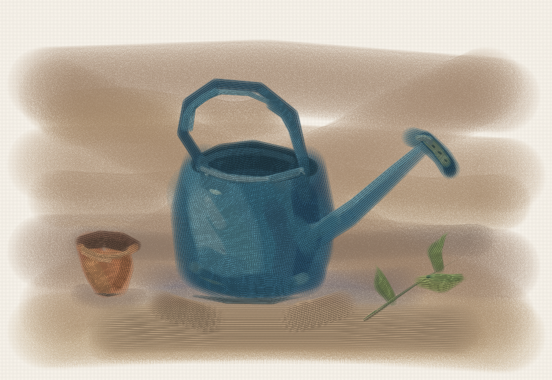](https://atelier.randomdrake.com/#painting/blue-keeps-a-little-rain)

An original still life in **112 animated marks**, developed through **29 settled paired inspections**, upper and lower reviews and deliberate final refinement. Broad overlaps closed the body before thin attachments; sampled rim arcs became rounder and a compact restored glint holds focus. Faceted handle, stiff leaf and raised bench repairs remain. Inspired by the [Smithsonian Gardens watering-can collection](https://gardens.si.edu/collections/explore/object/hac_2017.001.009). The broadcast ended with all 112 marks acknowledged.

[Watch the watering-can study unfold →](https://atelier.randomdrake.com/#painting/blue-keeps-a-little-rain)

### Small harvest on blue linen

[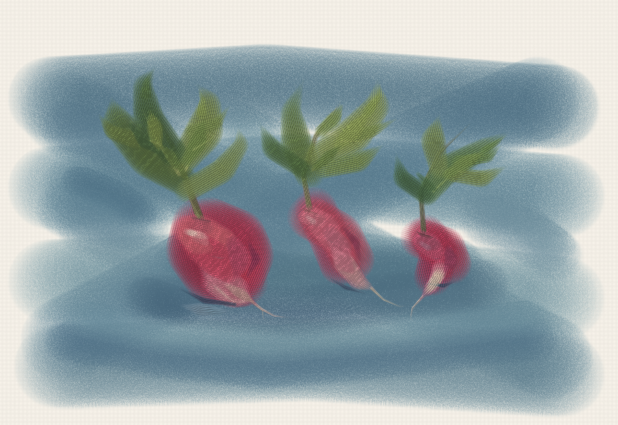](https://atelier.randomdrake.com/#painting/small-harvest-on-blue-linen)

An original still life in **112 animated marks**, developed through **29 settled paired inspection boundaries**, upper and lower camera reviews and a deliberate final refinement. Broad root planes preceded fine tails; broad red neighbors reduced dark crown brackets, and a restored compact shoulder light holds focus. Fan-like foliage, a right-tail elbow and raised repairs remain. Inspired by [Kew’s cultivated radish collection](https://powo.science.kew.org/taxon/urn%3Alsid%3Aipni.org%3Anames%3A77159305-1/general-information). The broadcast ended with all 112 marks acknowledged.

[Watch the radish study unfold →](https://atelier.randomdrake.com/#painting/small-harvest-on-blue-linen)

### What the rose keeps

[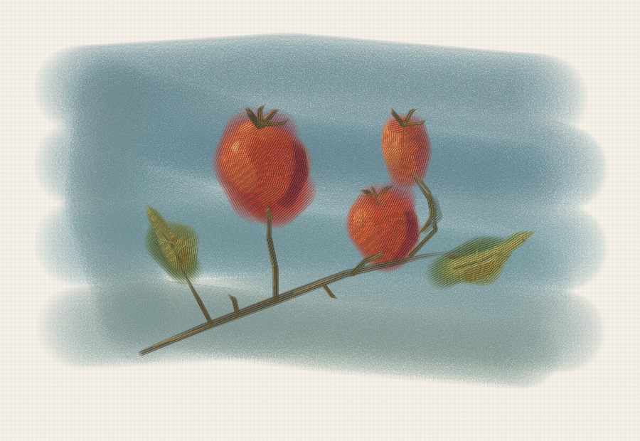](https://atelier.randomdrake.com/#painting/what-the-rose-keeps)

An original botanical study in **88 animated marks**, developed through **23 settled paired inspections**, lower and upper camera reviews and repeated final refinement review. Broad fruit planes preceded thin stems; one compact shoulder light holds focus. A twig correction doubled the line and left raised relief, retained as evidence. Inspired by the [NPS rose-hip reference](https://www.nps.gov/romo/rose_hips.htm). The broadcast ended with all 88 marks acknowledged.

[Watch the rose-hip study unfold →](https://atelier.randomdrake.com/#painting/what-the-rose-keeps)

### A red hull at rest

[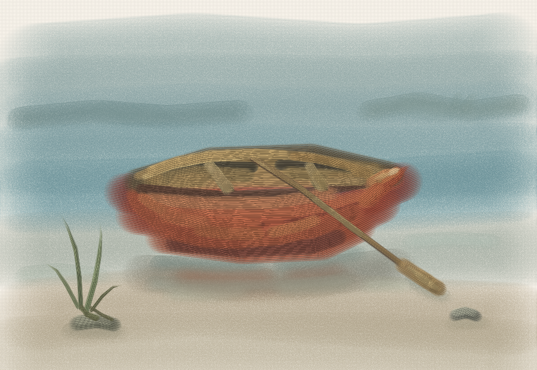](https://atelier.randomdrake.com/#painting/a-red-hull-at-rest)

An original shore study in **112 animated marks**, developed through **29 settled paired inspections**, upper and lower camera reviews and repeated final refinement review. Broad loaded hull planes and a compact restored bow light hold against soft watercolor reflections. Raised repairs, faceted rim and blunt blade remain. Inspired by the [NPS longboat reference](https://www.nps.gov/places/perryslongboat.htm). The broadcast ended with all 112 marks acknowledged.

[Watch the rowboat study unfold →](https://atelier.randomdrake.com/#painting/a-red-hull-at-rest)

### A cup of sun on still water

[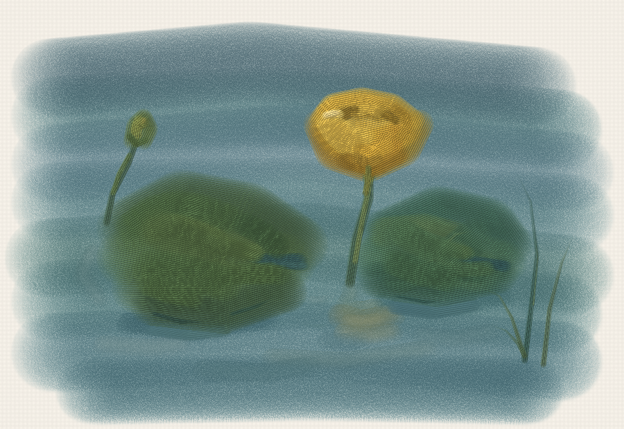](https://atelier.randomdrake.com/#painting/a-cup-of-sun-on-still-water)

An original pond study in **112 animated marks**, developed through **29 settled paired inspections**, upper and lower camera reviews and repeated final refinement review. Broad loaded planes filled the pads before sparse veins; a compact rim light holds the golden cup. Blunt notches, reed elbows and raised water-cover repairs remain. Inspired by the [NPS Denali pond-lily guide](https://www.nps.gov/dena/learn/nature/pondlily.htm). The broadcast ended with all112 marks acknowledged.

[Watch the pond study unfold →](https://atelier.randomdrake.com/#painting/a-cup-of-sun-on-still-water)

### Paper keeps the light

[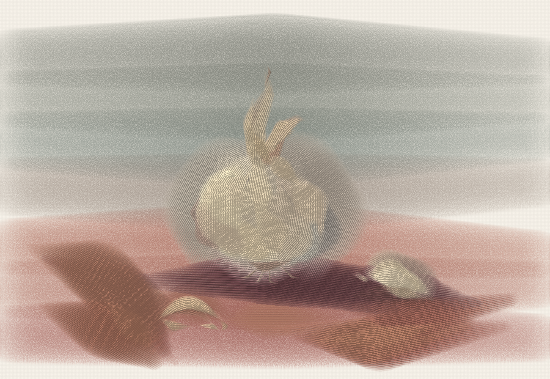](https://atelier.randomdrake.com/#painting/paper-keeps-the-light)

An original still life in **88 animated marks**, developed through **23 settled paired inspections**, upper and lower camera reviews and repeated final refinement review. Broad ivory planes filled the bulb and absorbed dark creases; a sampled skin curve and compact shoulder light hold the focus. Raised repairs, angular dry neck and large cloth patches remain. Inspired by [Kew’s garlic collection](https://www.kew.org/plants/garlic). The broadcast ended with all 88 marks acknowledged.

[Watch the garlic study unfold →](https://atelier.randomdrake.com/#painting/paper-keeps-the-light)

### A star in the retreating tide

[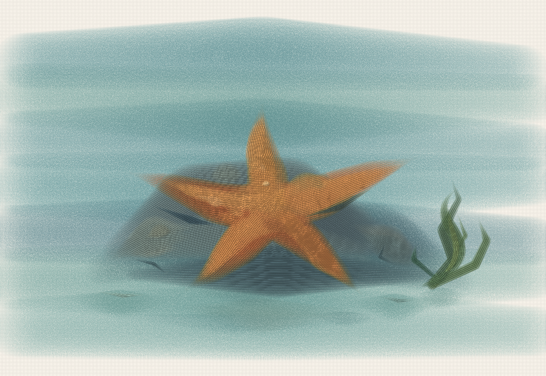](https://atelier.randomdrake.com/#painting/a-star-in-the-retreating-tide)

An original tide-pool study in **88 animated marks**, developed through **23 settled paired inspections**, lower and upper camera reviews and repeated final refinement review. Broad warm overlaps repaired dark slits and an accidental notch; a compact wet glint holds focus. Raised repairs, regular bristles and angular outer seaweed remain. Inspired by [NPS Redwood tide-pool photographs](https://www.nps.gov/redw/learn/nature/seastars.htm). The broadcast ended with all 88 marks acknowledged.

[Watch the tide-pool study unfold →](https://atelier.randomdrake.com/#painting/a-star-in-the-retreating-tide)

### A small climber in the blue

[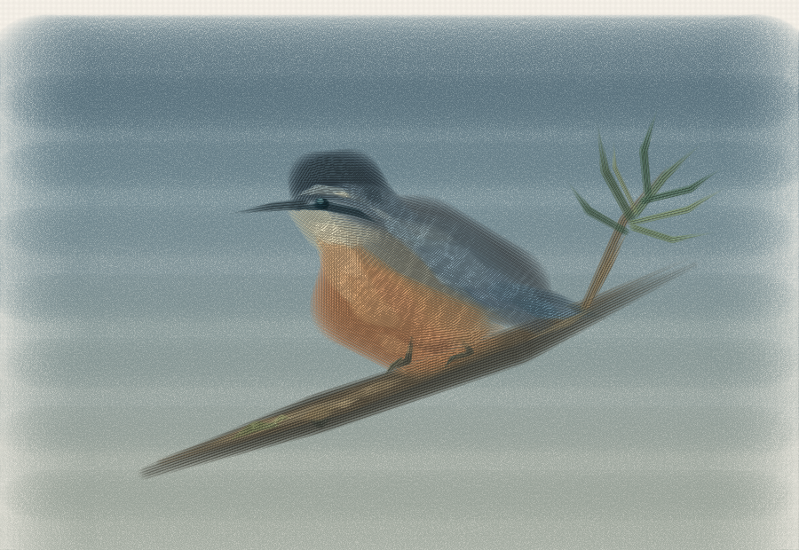](https://atelier.randomdrake.com/#painting/a-small-climber-in-the-blue)

An original bird study in **88 animated marks**, developed through **23 settled paired inspection boundaries**, upper and lower camera reviews and repeated final refinement review. Broad overlaps closed the body and reduced feather rails more clearly than a thin cover; a compact eye glint holds focus. Faceted cap, bracket-like toes and raised repairs remain. Inspired by the [NPS nuthatch guide](https://www.nps.gov/brca/learn/nature/nuthatches.htm). The broadcast ended with all 88 marks acknowledged.

[Watch the nuthatch study unfold →](https://atelier.randomdrake.com/#painting/a-small-climber-in-the-blue)

### Green armor, violet cloth

[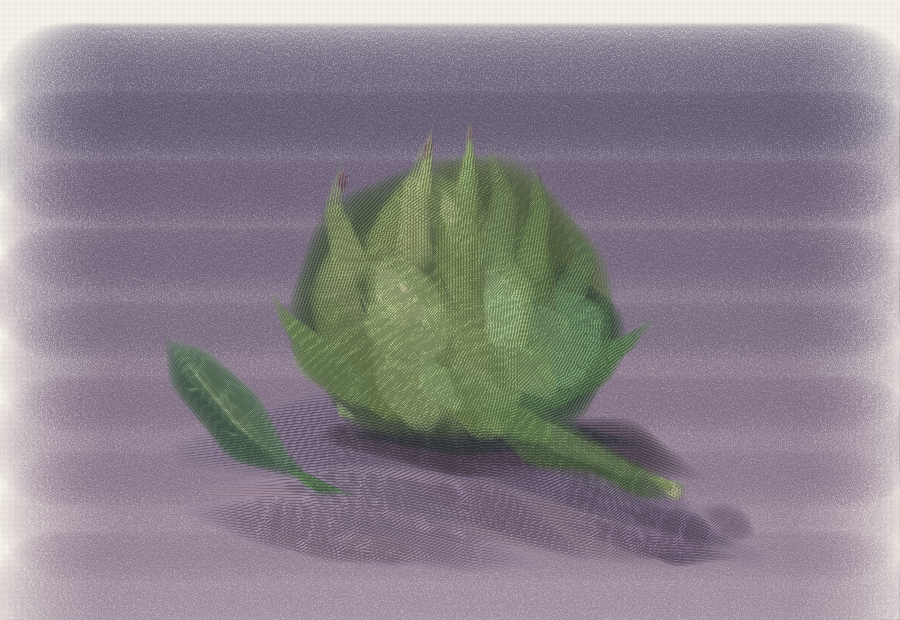](https://atelier.randomdrake.com/#painting/green-armor-violet-cloth)

An original still life in **112 animated marks**, developed through **29 settled paired inspection boundaries**, upper and lower camera reviews and repeated final refinement review. Broad diagonal overlaps filled the center and absorbed heavy seam bars; tapered tips clarify the silhouette and a compact restored bract light holds focus. Crown facets, raised green repairs and angular cloth folds remain. Inspired by the [NC State artichoke plant guide](https://plants.ces.ncsu.edu/plants/cynara-cardunculus-scolymus-group/). The broadcast ended with all 112 marks acknowledged.

[Watch the artichoke study unfold →](https://atelier.randomdrake.com/#painting/green-armor-violet-cloth)

### The kettle keeps the morning

[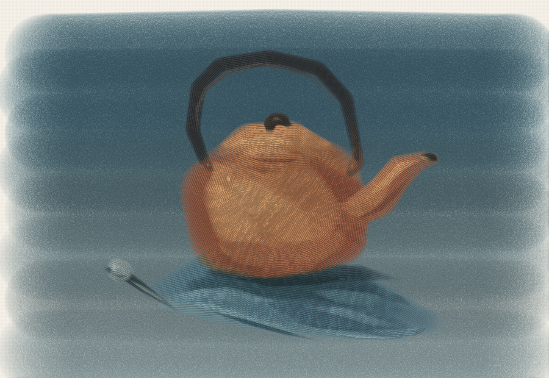](https://atelier.randomdrake.com/#painting/the-kettle-keeps-the-morning)

An original still life in **88 animated marks**, developed through **23 settled paired inspection boundaries**, upper and lower camera reviews and repeated final refinement review. Broad copper overlaps closed the center and absorbed narrow base stripes; one restored compact shoulder glint holds focus. Faceted fittings, angular cloth hem and raised seams remain. Inspired by the [Met copper kettle collection](https://www.metmuseum.org/art/collection/search/207823). The broadcast ended with all 88 marks acknowledged.

[Watch the kettle study unfold →](https://atelier.randomdrake.com/#painting/the-kettle-keeps-the-morning)

### Blue cups for the late light

[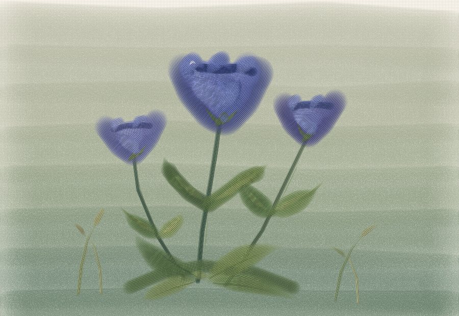](https://atelier.randomdrake.com/#painting/blue-cups-for-the-late-light)

An original meadow study in **112 animated marks**, developed through **29 settled paired inspection boundaries**, upper and lower camera reviews and repeated final refinement review. Broad overlaps joined the blue cups; tapered leaf extensions sharpened silhouettes, and one compact restored rim light holds focus. Matching covers barely changed heavy rim bars and left raised patches. Inspired by the [NPS meadow gentian guide](https://www.nps.gov/cebr/learn/nature/meadow-gentian.htm). The broadcast ended with all 112 marks acknowledged.

[Watch the gentian study unfold →](https://atelier.randomdrake.com/#painting/blue-cups-for-the-late-light)

### Rooms the sea once held

[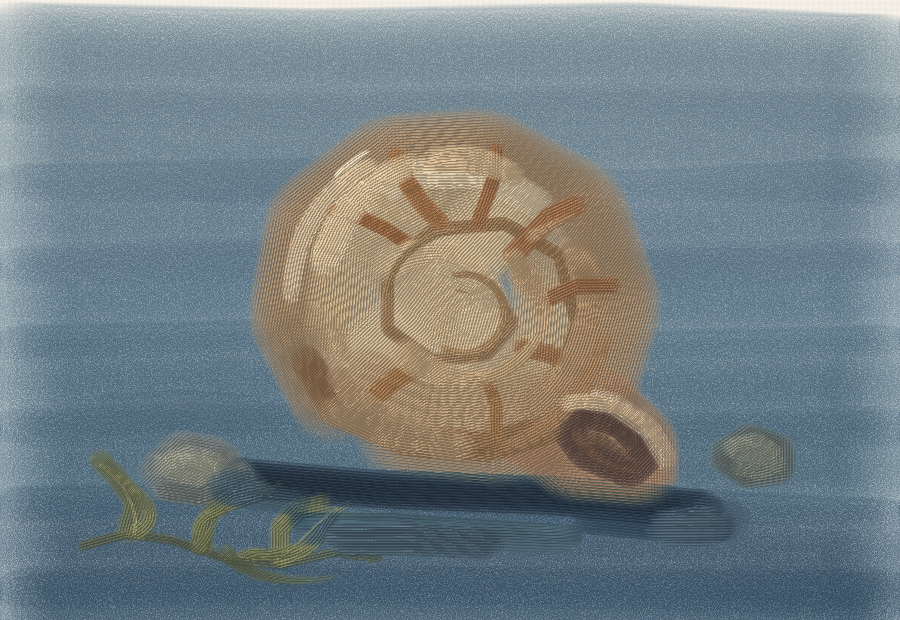](https://atelier.randomdrake.com/#painting/rooms-the-sea-once-held)

An original shell study in **88 animated marks**, developed through **23 settled paired inspection boundaries**, a lower camera review and repeated final refinement review. Broad overlaps filled most of the shell; a thin sampled repair reconnected the spiral and one compact rim light holds focus. Shadow covers spread raised blue rails, retained as a failed experiment. Faceted crown, blunt ribs and stiff kelp elbows remain. Inspired by the [Aquarium of the Pacific nautilus guide](https://www.aquariumofpacific.org/onlinelearningcenter/species/chambered_nautilus). The broadcast ended with all 88 marks acknowledged.

[Watch the shell study unfold →](https://atelier.randomdrake.com/#painting/rooms-the-sea-once-held)

### A hush on the old perch

[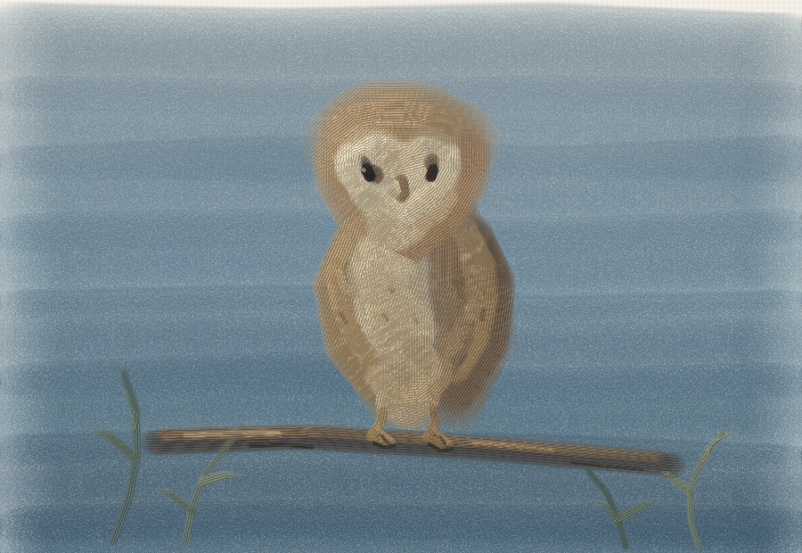](https://atelier.randomdrake.com/#painting/a-hush-on-the-old-perch)

An original owl study in **112 animated marks**, developed through **29 settled paired inspection boundaries**, upper and lower camera reviews and repeated final refinement review. Broad overlaps filled the body and face; pale cheek planes separated the mask, and one compact restored eye light holds focus. Covers reduced some seam contrast but left raised patches. Faceted crown, hooked beak, blunt feet and stiff reeds remain. Inspired by the [NPS owl guide](https://home.nps.gov/bibe/learn/nature/owls.htm). The broadcast ended with all 112 marks acknowledged.

[Watch the owl study unfold →](https://atelier.randomdrake.com/#painting/a-hush-on-the-old-perch)

### Two embers on blue linen

[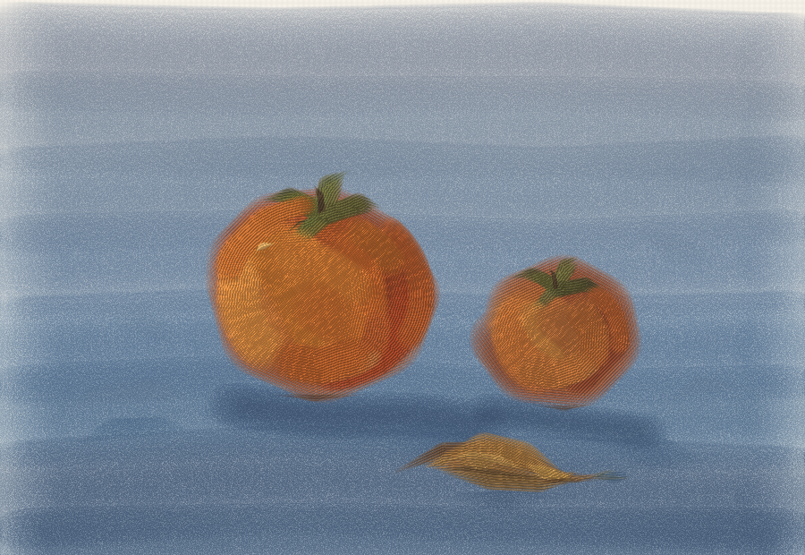](https://atelier.randomdrake.com/#painting/two-embers-on-blue-linen)

An original still life in **88 animated marks**, developed through **23 settled paired inspection boundaries**, a direct lower review and repeated final refinement review. Broad overlaps filled the fruit; wider diagonal bridges reduced hard middle seams, with one compact restored shoulder light. Covers left raised patches, while faceted shoulders, blunt stalks and a stiff leaf tail remain. Inspired by the [NPS woodland tree guide](https://www.nps.gov/mana/learn/nature/trees-and-shrubs.htm). The broadcast ended with all 88 marks acknowledged.

[Watch the persimmon study unfold →](https://atelier.randomdrake.com/#painting/two-embers-on-blue-linen)

### Fans for the October wind

[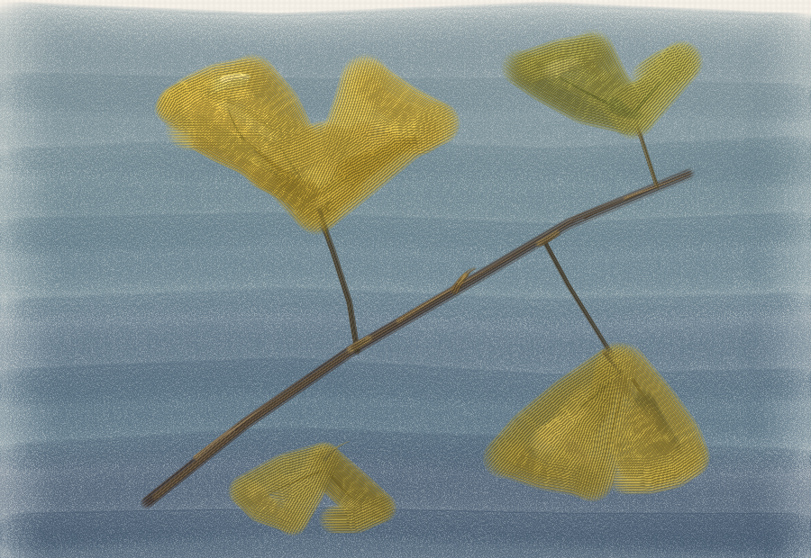](https://atelier.randomdrake.com/#painting/fans-for-the-october-wind)

An original autumn study in **112 animated marks**, developed through **29 settled paired inspection boundaries**, direct upper and lower camera reviews and repeated final refinement review. Broad overlaps filled the fan shapes; unequal curved veins stay quiet beneath one compact restored rim light. Matching covers reduced stripe contrast but left raised seams, with faceted silhouettes and hooked veins retained. Inspired by the [Smithsonian Gardens ginkgo collection](https://gardens.si.edu/collections/explore/object/ofeo-sg_2013-0618A). The broadcast ended with all 112 marks acknowledged.

[Watch the ginkgo study unfold →](https://atelier.randomdrake.com/#painting/fans-for-the-october-wind)

### A house for still water

[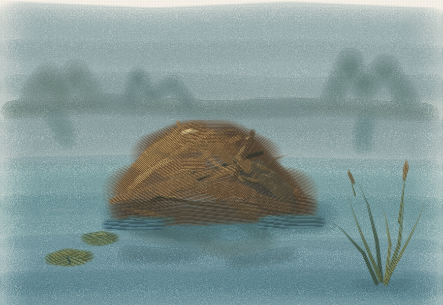](https://atelier.randomdrake.com/#painting/a-house-for-still-water)

An original pond study in **112 animated marks**, developed through **29 settled paired inspection boundaries**, a lower camera review and repeated final refinement review. Broad loaded paint joined warm dome planes and filled the pads; sampled curves softened reed bends. One compact crown light holds focus. Water covers enlarged raised blue rails; stiff branch crossings and a segmented seed stem remain. Inspired by the [NPS Voyageurs beaver guide](https://www.nps.gov/voya/learn/nature/beavers.htm). The broadcast ended with all 112 marks acknowledged.

[Watch the lodge study unfold →](https://atelier.randomdrake.com/#painting/a-house-for-still-water)

### A turn kept in stone

[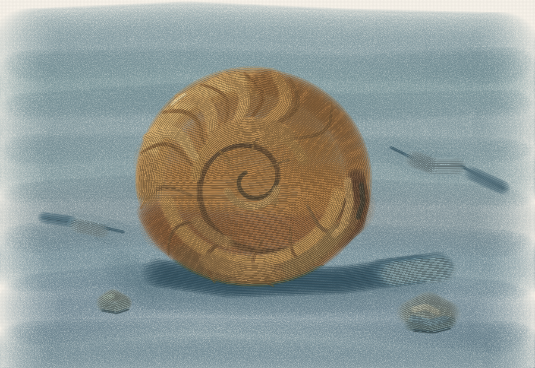](https://atelier.randomdrake.com/#painting/a-turn-kept-in-stone)

An original fossil study in **88 animated marks**, developed through **23 settled paired inspection boundaries**, a lower camera review and repeated final refinement review. Broad overlaps joined the shell; loaded warm planes turned the ribs more clearly than thin passes, and a short repair restored the spiral. One compact rim light holds focus. Shadow and seam covers left raised patches; hooked rib ends and regular relief remain. Inspired by the [NPS fossil mollusk guide](https://www.nps.gov/articles/000/fossil-mollusks.htm). The broadcast ended with all 88 marks acknowledged.

[Watch the fossil study unfold →](https://atelier.randomdrake.com/#painting/a-turn-kept-in-stone)

### A small voyage in blue

[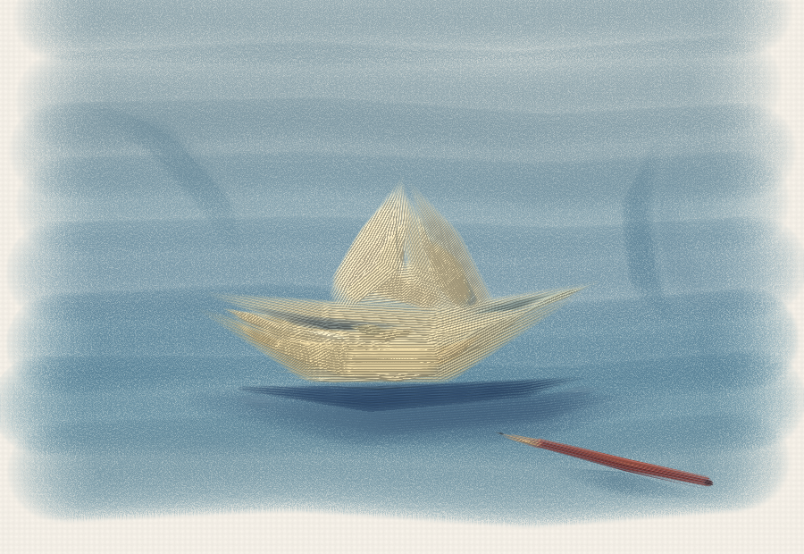](https://atelier.randomdrake.com/#painting/a-small-voyage-in-blue)

An original still life in **80 animated marks**, developed through **21 paired inspection boundaries**, a lower detail review and repeated final refinement review. Broad overlaps closed a hollow fold; a wider warm oil plane reduced a grey facet more clearly than narrow covers. A compact rim light and quiet red pencil hold the focus. Shadow covers left raised relief; stiff cloth bends and regular ridges remain. Inspired by the [Smithsonian paper boat collection](https://americanhistory.si.edu/collections/object/nmah_2023272). The broadcast ended with all 80 marks acknowledged.

[Watch the paper boat unfold →](https://atelier.randomdrake.com/#painting/a-small-voyage-in-blue)

### Night gathered on a branch

[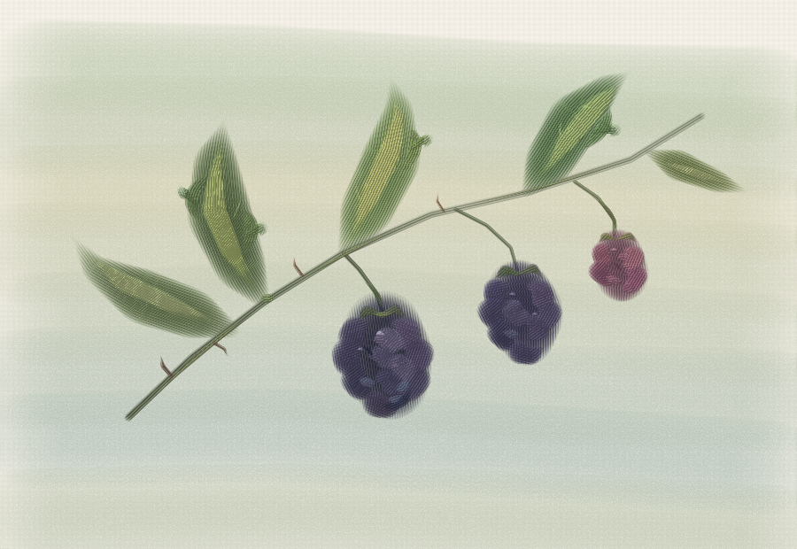](https://atelier.randomdrake.com/#painting/night-gathered-on-a-branch)

An original branch study in **112 animated marks**, developed through **29 paired inspection boundaries**, a direct upper review and repeated final refinement review. Long gestures joined the leaves; unequal scallops and compact upper-left lights turn the berries. Tapered cane thorns read clearly; leaf teeth became blunt hooks, and covers only partly reduced them. Inspired by the [NPS blackberry guide](https://www.nps.gov/olym/learn/nature/himalayan-blackberry.htm). The broadcast ended with all 112 marks acknowledged.

[Watch the branch study unfold →](https://atelier.randomdrake.com/#painting/night-gathered-on-a-branch)

### An opening for evening

[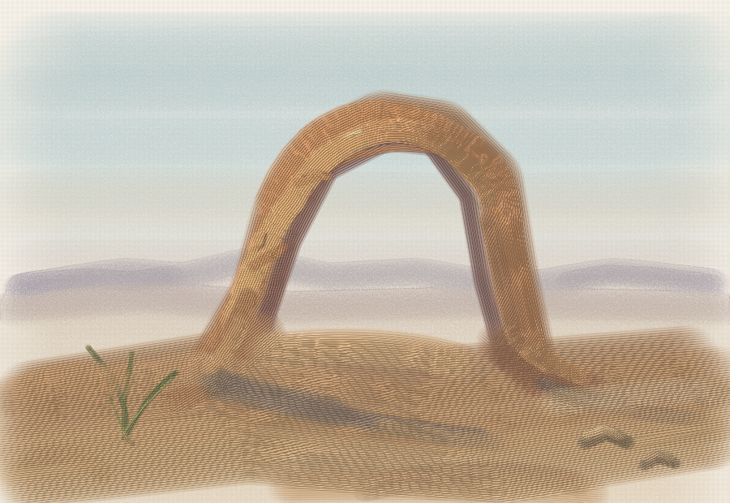](https://atelier.randomdrake.com/#painting/an-opening-for-evening)

An original desert study in **88 animated marks**, developed through **23 paired inspection boundaries**, a direct upper review and repeated final refinement review. Long overlaps joined the stone; violet inner walls give thickness and one compact crown light stays focal. Thin oil shortened shadow tails, while watercolor and acrylic barely changed oil. Ground covers spread raised patches; shoulder facets and a short fissure remain. Inspired by the [NPS Delicate Arch guide](https://www.nps.gov/arch/planyourvisit/delicate-arch.htm). The broadcast ended with all 88 marks acknowledged.

[Watch the arch study unfold →](https://atelier.randomdrake.com/#painting/an-opening-for-evening)


### Four wings over quiet water

[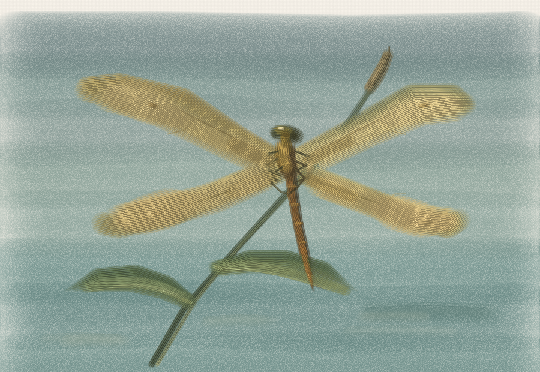](https://atelier.randomdrake.com/#painting/four-wings-over-quiet-water)

An original pond study in **112 animated marks**, developed through **29 paired inspection boundaries**, a direct lower review and repeated final review. Broad overlaps joined the wings; fine ribs stay quiet and one compact restored head light holds focus. Wet watercolor softened a dark reflection. Oil root covers left raised patches; bracket legs, faceted leaves and regular relief remain. Inspired by the [NPS dragonfly guide](https://www.nps.gov/articles/species-spotlight-dragonflies.htm). The broadcast ended with all 112 marks acknowledged.

[Watch the dragonfly study unfold →](https://atelier.randomdrake.com/#painting/four-wings-over-quiet-water)

### A warmth kept for later

[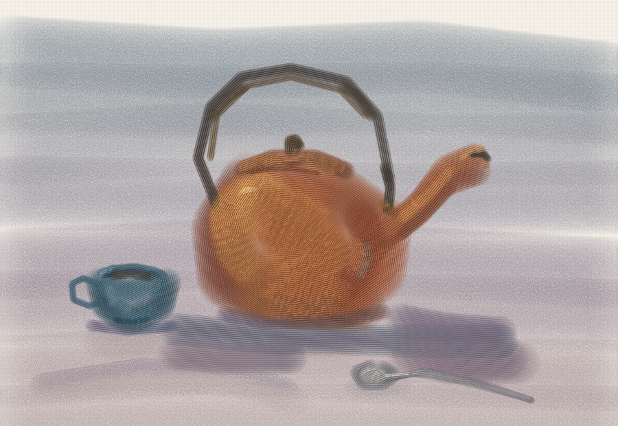](https://atelier.randomdrake.com/#painting/a-warmth-kept-for-later)

An original still life in **84 animated marks**, developed through **22 paired inspection boundaries**, a lower camera review and repeated final review. Broad overlaps joined the copper; one compact restored shoulder light holds the focus. Violet shadow covers enlarged raised pads, and acrylic barely changed them: retained failed experiments. Faceted handle, cup and spoon edges and regular relief remain. Inspired by [The Met’s copper teakettle](https://www.metmuseum.org/art/collection/search/2536). The broadcast ended with all 84 marks acknowledged.

[Watch the kettle study unfold →](https://atelier.randomdrake.com/#painting/a-warmth-kept-for-later)

### Five petals the tide remembers

[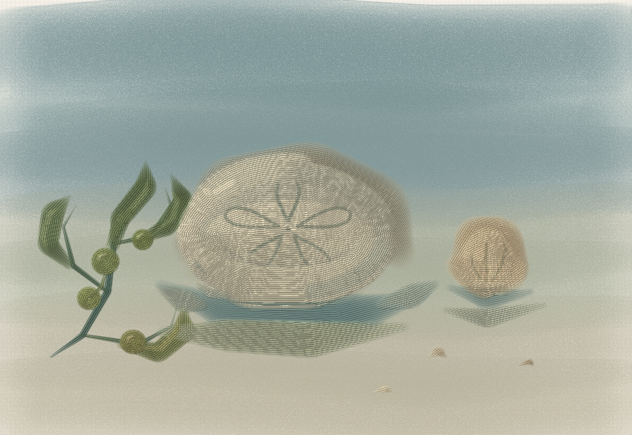](https://atelier.randomdrake.com/#painting/five-petals-the-tide-remembers)

An original shore study in **84 animated marks**, developed through **22 paired inspection boundaries** and repeated final review. Broad overlaps joined the shell and absorbed an internal band; five petals and one short restored rim light hold the focus. Shadow covers changed color but enlarged relief patches, retained as a failed correction. Crown facets, stiff wrack bends and a pale repair patch remain. Inspired by the [NPS Secrets of the Sand wayside](https://www.nps.gov/places/axs_214.htm). The broadcast ended with all 84 marks acknowledged.

[Watch the shore study unfold →](https://atelier.randomdrake.com/#painting/five-petals-the-tide-remembers)

### A blue pause above water

[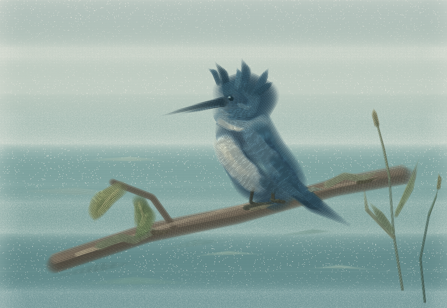](https://atelier.randomdrake.com/#painting/a-blue-pause-above-water)

An original kingfisher study in **96 animated marks**, developed through **25 paired inspection boundaries**, an upper camera review and repeated final review. Broad overlaps joined the body; a pale collar and compact revised eye light hold the focus. Blue paint repaired a bark overshoot, leaving relief. Stiff crest, bracket feet and a pale breast ledge remain. Inspired by the [NPS kingfisher guide](https://www.nps.gov/prsf/learn/nature/belted-kingfisher.htm). The broadcast ended with all 96 marks acknowledged.

[Watch the kingfisher study unfold →](https://atelier.randomdrake.com/#painting/a-blue-pause-above-water)

### Where the sand turns blue

[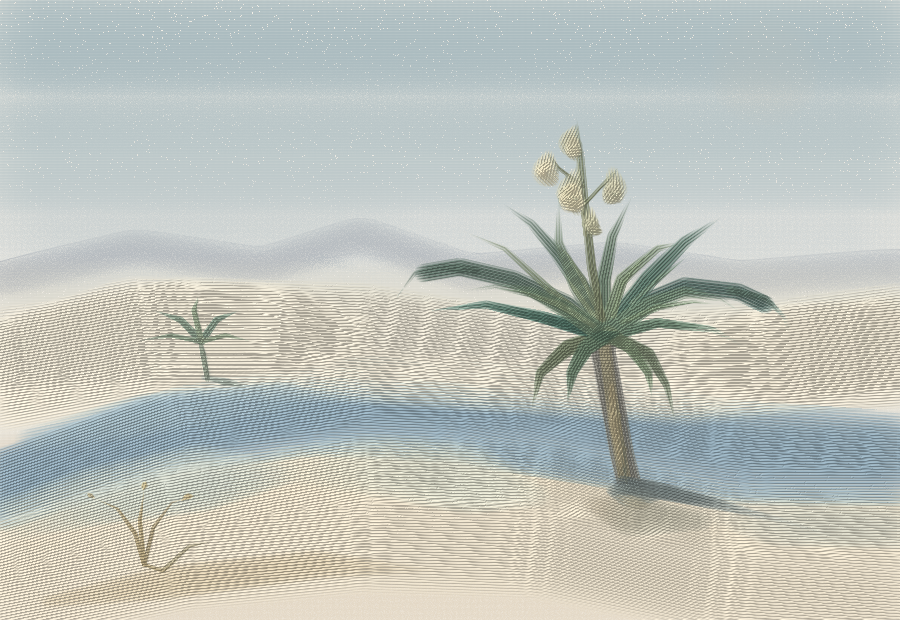](https://atelier.randomdrake.com/#painting/where-the-sand-turns-blue)

An original dune study in **113 completed marks**, including one accidental setup dab. Long overlaps joined the sand planes; tapered leaves and one compact flower light hold the focus. Loaded sand covered the distant plant, which was restored; relief patches remain. Developed through **27 correctly framed paired inspection boundaries**, an upper pan and repeated final review. Inspired by the [NPS White Sands plant guide](https://home.nps.gov/whsa/learn/nature/plant-survival-strategies.htm). The broadcast ended with all 113 marks acknowledged.

[Watch the dune study unfold →](https://atelier.randomdrake.com/#painting/where-the-sand-turns-blue)

### Three small fires in the mist

[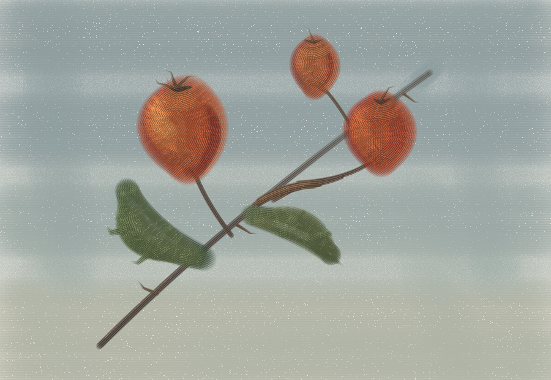](https://atelier.randomdrake.com/#painting/three-small-fires-in-the-mist)

An original rosehip study in **112 marks**, developed through **29 distinct paired inspection boundaries**, a direct upper pan and repeated final review. Long warm overlaps joined the fruit; a loaded crossing repair attached the fork and one compact near-shoulder light stayed focal. Leaf teeth became hooks, and covers only partly softened relief. Inspired by the [NPS rosehip guide](https://www.nps.gov/romo/rose_hips.htm). The broadcast ended with all 112 marks acknowledged.

[Watch the rosehip study unfold →](https://atelier.randomdrake.com/#painting/three-small-fires-in-the-mist)

### Where the grass listens

[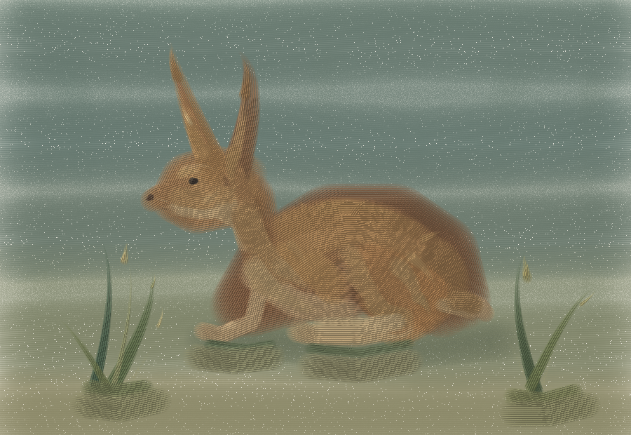](https://atelier.randomdrake.com/#painting/where-the-grass-listens)

An original hare study in **112 marks**, developed through **29 distinct paired inspection boundaries**, a direct upper pan and repeated final review. Long overlaps joined body and ears; one short ear light stays compact. Thin shadows became brackets and ground covers enlarged raised pads, retained as failed experiments. Inspired by the [NPS Olympic hare guide](https://www.nps.gov/olym/learn/nature/snowshoe-hare.htm). The broadcast ended with all 112 marks acknowledged.

[Watch the hare study unfold →](https://atelier.randomdrake.com/#painting/where-the-grass-listens)


### A green room under water

[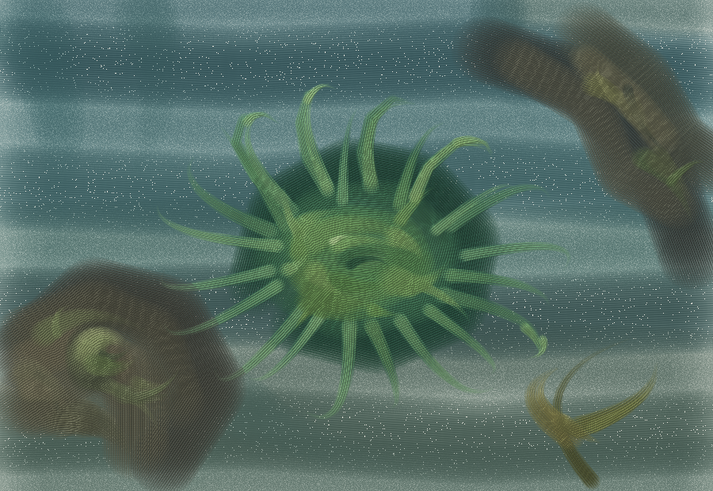](https://atelier.randomdrake.com/#painting/a-green-room-under-water)

An original tidepool study in **112 marks**, developed through **29 distinct paired inspection boundaries**, a direct lower-left pan and repeated final review. Broad overlaps joined the cup; denser curved paths softened tentacle turns, and one compact light stays focal. Stone seam and root covers only partly corrected hard fragments, leaving raised patches. Inspired by the [NPS anemone guide](https://www.nps.gov/places/anemone.htm). The broadcast ended with all 112 marks acknowledged.

[Watch the tidepool study unfold →](https://atelier.randomdrake.com/#painting/a-green-room-under-water)


### Shelves of quiet rain

[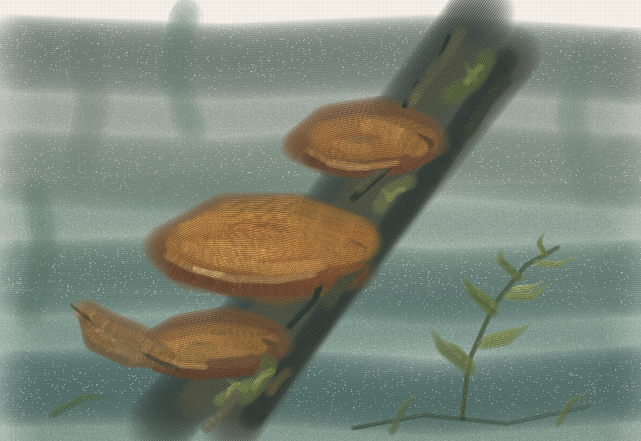](https://atelier.randomdrake.com/#painting/shelves-of-quiet-rain)

An original forest study in **112 marks**, developed through **29 distinct paired inspection boundaries**, a direct fern pan and repeated final review. Broad overlaps joined the shelves and closed a leaf slit; one short rim light stays compact. Narrow root shadows became hooks and warm covers only partly corrected them, leaving raised patches. Inspired by the [NPS Olympic fungi guide](https://www.nps.gov/olym/learn/nature/fungi.htm). The broadcast ended with all 112 marks acknowledged.

[Watch the shelf study unfold →](https://atelier.randomdrake.com/#painting/shelves-of-quiet-rain)

### Keys for the wind

[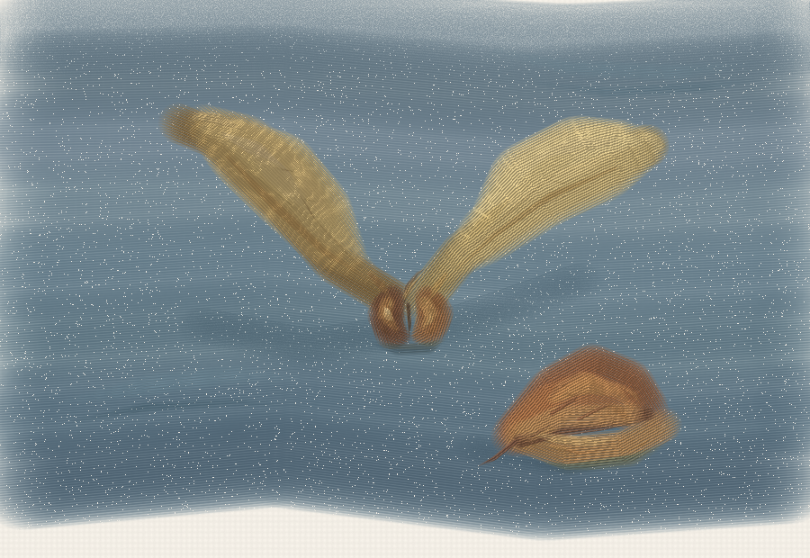](https://atelier.randomdrake.com/#painting/keys-for-the-wind)

An original quiet still life in **84 marks**, developed through **22 distinct paired inspection boundaries**, a single-mark light check and repeated final review. Broad overlaps joined the papery wings; fine veins stay quiet and one compact seed light holds the focus. Warm paint closed an accidental leaf slit, while later wing covers only partly softened raised patches. Inspired by the [NPS bigleaf maple guide](https://home.nps.gov/articles/000/bigleaf-maple.htm). The broadcast ended with all 84 marks acknowledged.

[Watch the maple study unfold →](https://atelier.randomdrake.com/#painting/keys-for-the-wind)

### A small fire before migration

[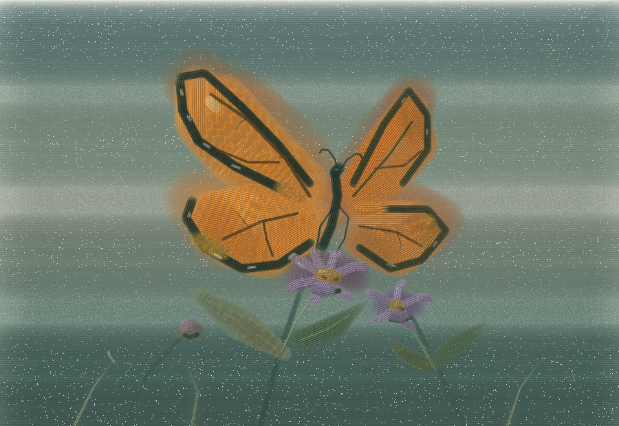](https://atelier.randomdrake.com/#painting/a-small-fire-before-migration)

An original monarch study in **112 marks**, developed through **29 distinct paired inspection boundaries**, direct upper review and repeated final review. Broad loaded overlaps joined the wings; fine veins and one compact shoulder light stay subordinate to the orange planes. Warm border repairs and violet calyx covers partly corrected blunt bars, leaving mixed patches. Inspired by the [NPS monarch migration guide](https://www.nps.gov/subjects/pollinators/migratingmonarchs.htm). The broadcast ended with all 112 marks acknowledged.

[Watch the monarch study unfold →](https://atelier.randomdrake.com/#painting/a-small-fire-before-migration)


### The dusk has a face

[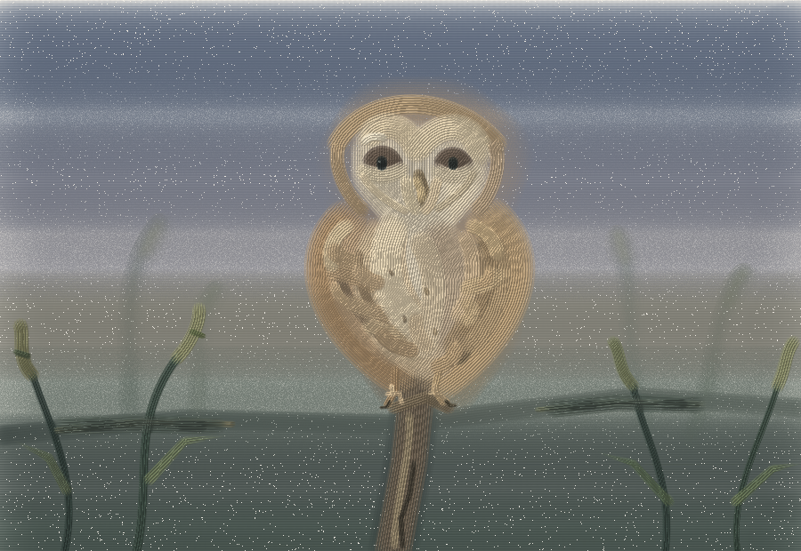](https://atelier.randomdrake.com/#painting/the-dusk-has-a-face)

An original owl study in **112 marks**, developed through **29 distinct paired inspection boundaries**, direct upper review and repeated final review. Broad warm overlaps closed a hollow wing; curved side planes joined crown and cheek. One compact brow light stays focal. Long feather shadows became bars, and rail covers left ridged patches: retained failed experiments. Inspired by the [NPS owl guide](https://home.nps.gov/bibe/learn/nature/owls.htm). The broadcast ended with all 112 marks acknowledged.

[Watch the owl study unfold →](https://atelier.randomdrake.com/#painting/the-dusk-has-a-face)


### Blue keeps the mountain

[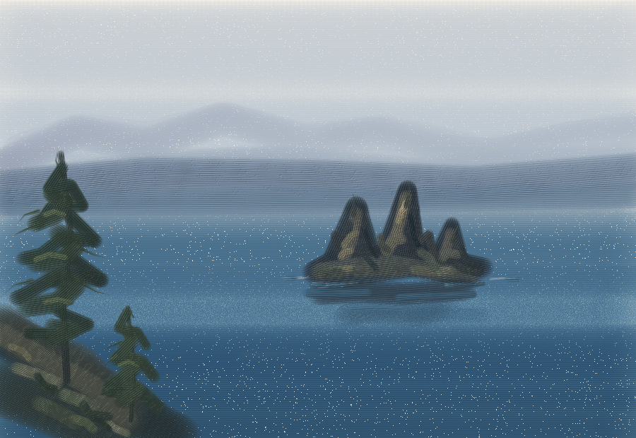](https://atelier.randomdrake.com/#painting/blue-keeps-the-mountain)

An original lake study in **112 marks**, developed through **29 distinct paired inspection boundaries** and a direct left-pine review. Broad overlaps joined the island and pines; one short warm spire light stays compact. Thin rim oil and reflection covers left regular relief, a retained failed experiment. Inspired by the [NPS Crater Lake guide](https://www.nps.gov/crla/index.htm). The broadcast ended with all 112 marks acknowledged.

[Watch the lake study unfold →](https://atelier.randomdrake.com/#painting/blue-keeps-the-mountain)

### Silk before the wind

[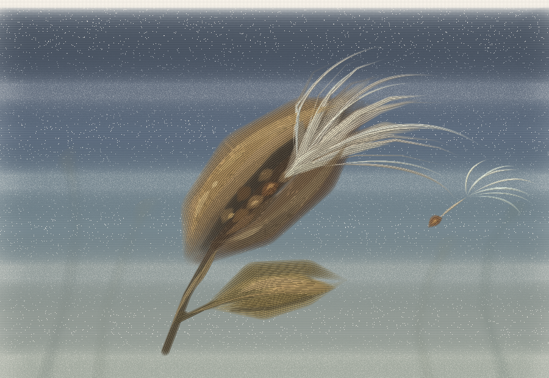](https://atelier.randomdrake.com/#painting/silk-before-the-wind)

An original autumn study in **112 marks**, developed through **29 distinct paired inspection boundaries** and repeated final review. Broad overlaps joined shell and leaf; loaded oil made clearer silk than thin oil and chalk, while sampled curves reduced angular turns. The last interior cover left a light ridged patch, a retained failed correction. Inspired by the [NPS common milkweed guide](https://www.nps.gov/gate/learn/nature/common-milkweed.htm). The broadcast ended with all 112 marks acknowledged.

[Watch the milkweed study unfold →](https://atelier.randomdrake.com/#painting/silk-before-the-wind)

### White step, green silence

[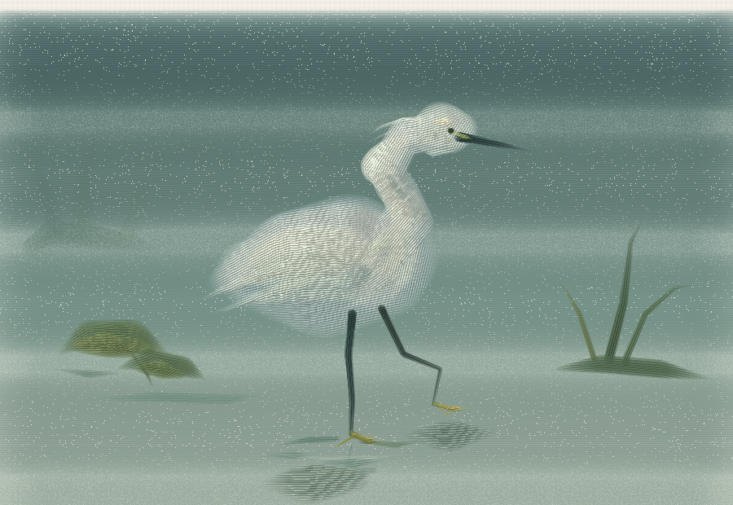](https://atelier.randomdrake.com/#painting/white-step-green-silence)

An original marsh study in **96 marks**, developed through **25 distinct paired inspection boundaries** and repeated final review. Long gestures joined the neck and body; thinner cool paint separated the lower wing and one short brow light stayed compact. Broad overlaps filled hollow leaves. Reflection-cover attempts enlarged ridged water patches, a retained failed experiment. Inspired by the [NPS snowy egret guide](https://www.nps.gov/prsf/learn/nature/snowy-egret.htm). The broadcast ended with all 96 marks acknowledged.

[Watch the white step unfold →](https://atelier.randomdrake.com/#painting/white-step-green-silence)

### Ember curled in frost

[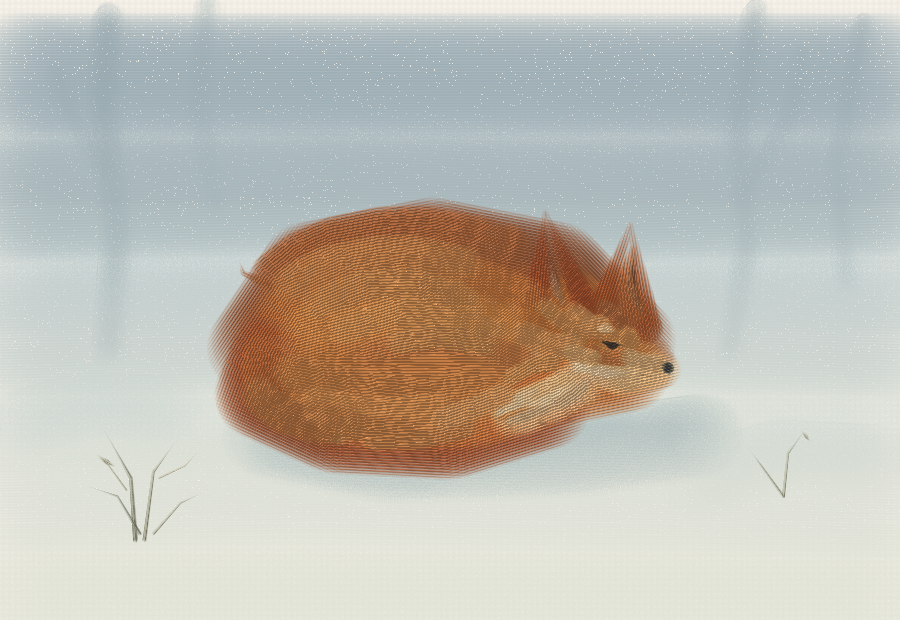](https://atelier.randomdrake.com/#painting/ember-curled-in-frost)

An original winter study in **96 marks**, developed through **25 distinct paired inspection boundaries** and repeated final review. Long warm overlaps joined the body and tail; one short brow light stays compact against quiet snow. Broad matching paint repaired a dark fold bar and pale tail patch. Faceted crown, blunt cream tip, angular grasses and regular oil ridges remain. Inspired by the [NPS Isle Royale red fox guide](https://www.nps.gov/isro/learn/nature/red-fox.htm). The broadcast ended with all 96 marks acknowledged.

[Watch the sleeping fox unfold →](https://atelier.randomdrake.com/#painting/ember-curled-in-frost)

### Slow gold on the forest floor

[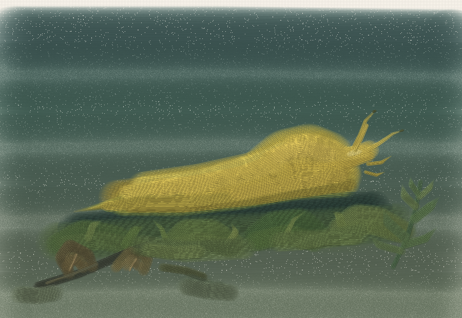](https://atelier.randomdrake.com/#painting/slow-gold-on-the-forest-floor)

An original forest-floor study in **92 marks**, developed through **24 distinct paired inspection boundaries** and repeated final review. Long overlaps joined the tapered body; a short head light stays compact. Broad gold partly repaired narrow fold bars. Ground covers widened regular relief, a retained failed experiment. Inspired by the [NPS Redwood banana slug guide](https://www.nps.gov/redw/learn/nature/banana-slug-and-millipede.htm). The broadcast ended with all 92 marks acknowledged.

[Watch the forest-floor study unfold →](https://atelier.randomdrake.com/#painting/slow-gold-on-the-forest-floor)

### Small stores of autumn

[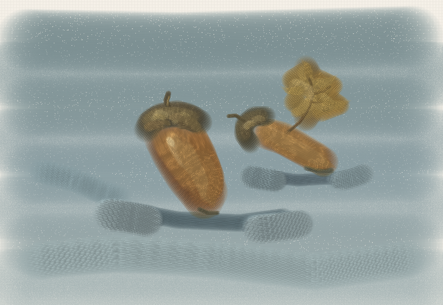](https://atelier.randomdrake.com/#painting/small-stores-of-autumn)

An original autumn still life in **100 marks**, developed through **26 distinct paired inspection boundaries** and repeated final review. Long overlaps joined solid nuts; one short shoulder light stays compact. Broad warm paint repaired a crossing stem and hard shadow bar. Shadow-cover trials left broad regular relief; scalloped leaf edges and soft tips remain. Inspired by the [NPS oak study](https://www.nps.gov/articles/species-spotlight-oaks.htm). The broadcast ended with all 100 marks acknowledged.

[Watch the acorn study unfold →](https://atelier.randomdrake.com/#painting/small-stores-of-autumn)

### Cups of borrowed sun

[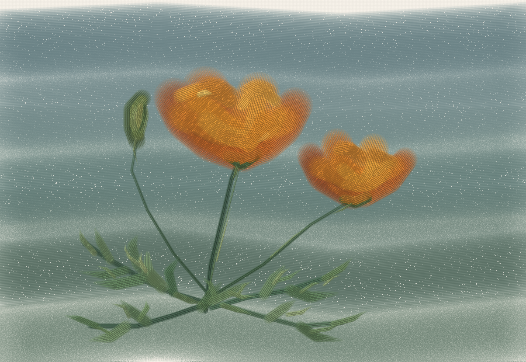](https://atelier.randomdrake.com/#painting/cups-of-borrowed-sun)

An original flower study in **112 marks**, developed through **29 settled whole-and-close inspection boundaries**. Broad filled planes joined the cups; loaded orange repaired hard rust fold bars, and one short restored lip light stays compact. Scalloped tops, angular foliage, field bands and regular simulated ridges remain. Inspired by the [NPS California poppy guide](https://www.nps.gov/prsf/learn/nature/california-poppy.htm). The broadcast ended with all 112 marks acknowledged.

[Watch the poppy study unfold →](https://atelier.randomdrake.com/#painting/cups-of-borrowed-sun)

### Arms full of evening

[](https://atelier.randomdrake.com/#painting/arms-full-of-evening)

An original desert study in **112 marks**, developed through **29 distinct paired inspection boundaries** and repeated final review. Long curved gestures join solid arms; one compact crown light holds the focus. Vertical overlaps repaired dark bars from a crosswise texture experiment. Ground covers spread relief, while short pale loaded facets clarified stones. Inspired by the [NPS saguaro guide](https://www.nps.gov/sagu/learn/nature/saguaro.htm). The live broadcast ended with all 112 marks acknowledged.

[Watch the desert study unfold →](https://atelier.randomdrake.com/#painting/arms-full-of-evening)

### A room inside the tide

[](https://atelier.randomdrake.com/#painting/a-room-inside-the-tide)

An original shell study in **96 marks**, developed through **25 distinct paired inspection boundaries** and repeated final review. Long curved gestures keep the coil flowing; broad ivory joins the shell planes. A small rim light stays subtle. Foreground covers spread regular paint relief, a useful failed correction. The live feed ended with all 96 marks acknowledged.

[Watch the chambered shell unfold →](https://atelier.randomdrake.com/#painting/a-room-inside-the-tide)

### Violet, held in clay

[](https://atelier.randomdrake.com/#painting/violet-held-in-clay)

An original flower still life in **112 marks**, developed through **29 distinct paired inspection boundaries** and repeated final review. Broad lilac overlaps joined the petals; one short throat light holds the focus. A loaded clay lip covered a stem overshoot. Ground covers first enlarged patches; loaded light oil shortened the shadow and joined the cloth, leaving heavy relief. Inspired by the [NPS Douglas iris guide](https://www.nps.gov/prsf/learn/nature/douglas-iris.htm). The broadcast ended with all 112 marks acknowledged.

[Watch the iris study unfold →](https://atelier.randomdrake.com/#painting/violet-held-in-clay)

### Ruby, opened

[](https://atelier.randomdrake.com/#painting/ruby-open)

An original orchard still life in **112 marks**, developed through **29 distinct paired inspection boundaries** and a repeated final review. Broad overlaps closed a rind slit and reduced harsh seed shadows; unequal clusters break the membrane spokes while one short rind light holds the focus. Cloth covers partly shortened dark folds but left ridged patches. Inspired by the [Tumacácori orchard guide](https://www.nps.gov/places/tour-orchard.htm). The broadcast ended with all 112 marks acknowledged.

[Watch the pomegranate study unfold →](https://atelier.randomdrake.com/#painting/ruby-open)

### Amber pause

[](https://atelier.randomdrake.com/#painting/amber-pause)

An original insect study in **112 marks**, developed through **29 distinct paired inspection boundaries** and a repeated final review. Long tapered wing gestures meet in a solid thorax; one short head light holds the focus. Narrow covers created dark ridged patches, while broad amber reclaim absorbed most of them and closed a split tip. Uneven edges, angular limbs and regular oil ridges remain. Inspired by [NPS Flying Jewels](https://www.nps.gov/articles/000/nature-watch-flying-jewels-living-flashes-of-light.htm). The broadcast ended with all 112 marks acknowledged.

[Watch the dragonfly study unfold →](https://atelier.randomdrake.com/#painting/amber-pause)

### Where the tide rests

[](https://atelier.randomdrake.com/#painting/where-the-tide-rests)

An original tide-pool study in **96 marks**, developed through **25 distinct inspection boundaries** and a repeated final review. Tapered center-out gestures joined five arms without a hollow center; one short loaded light stays compact. Misplaced rock planes crossed two arms and warm repairs restored continuity partly, leaving notches and extra texture. Inspired by the [NPS Point Reyes tidepool guide](https://www.nps.gov/thingstodo/point-reyes-tidepooling.htm). The broadcast ended with all 96 marks acknowledged.

[Watch the tide-pool study unfold →](https://atelier.randomdrake.com/#painting/where-the-tide-rests)

### Red mug, morning hush

[](https://atelier.randomdrake.com/#painting/red-mug-morning-hush)

An original camp still life in **112 marks**, developed through **29 paired inspection boundaries**. Broad crosswise paint filled the cup; a continuous rim and one short shoulder reflection hold the focus. Watercolor steam stays soft. Shadow covers widened ridged patches and handle covers left islands; angular edges remain. The broadcast ended with all 112 marks acknowledged.

[Watch the camp study unfold →](https://atelier.randomdrake.com/#painting/red-mug-morning-hush)

### River watch

[](https://atelier.randomdrake.com/#painting/river-watch)

An original kingfisher in **96 marks**, developed through **26 paired inspection boundaries** and an upper head review. Broad overlapping planes filled the body; curved gestures established the perch and one short brow light held the focus. Narrow band covers left pale rims; regular oil ridges remain. The live broadcast ended with all 96 marks acknowledged.

[Watch the river study unfold →](https://atelier.randomdrake.com/#painting/river-watch)

### The pearl turn

[](https://atelier.randomdrake.com/#painting/the-pearl-turn)

An original shell study in **96 marks**, developed through **26 whole-and-close inspection boundaries**. Broad cream overlaps closed the hollow block-in; a selective bridge restored the spiral after a shadow pass. One short shoulder light stays focal. Cloth and band covers were partial corrections; angular turns, a hard cast shadow and regular oil ridges remain. Inspired by [NOAA’s nautilus guide](https://oceanservice.noaa.gov/facts/nautilus.html/). The broadcast ended with all 96 marks confirmed.

[Watch the shell study unfold →](https://atelier.randomdrake.com/#painting/the-pearl-turn)

### Wind timber

[](https://atelier.randomdrake.com/#painting/wind-timber)

An original pine study in **112 marks**, developed through **29 whole-and-close inspection boundaries**. Broad warm planes turn the trunk; one short bend light stays focal. A warm overlap joined the branch collar and fine needle ends broke smooth caps. Soil covers added ridges without removing contact bars. Angular elbows and pale horizon fragments remain. Inspired by the [NPS bristlecone guide](https://www.nps.gov/brca/learn/nature/bristleconepine.htm). The broadcast ended with all 112 marks confirmed.

[Watch the pine study unfold →](https://atelier.randomdrake.com/#painting/wind-timber)

### Trumpet for the blue hour

[](https://atelier.randomdrake.com/#painting/trumpet-for-the-blue-hour)

An original evening flower in **112 marks**, developed through **29 whole-and-close inspection boundaries**. Broad loaded overlaps closed the hollow trumpet; a single short lip light stayed focal. A blue fold was reduced with ivory, while watery background gestures barely changed dry bands. Faceted lobes, blunt leaf ends and regular oil ridges remain. Inspired by the [NPS Arches datura guide](https://www.nps.gov/arch/learn/nature/solanaceae_datura_wrightii.htm). The broadcast ended with all 112 marks confirmed.

[Watch the trumpet unfold →](https://atelier.randomdrake.com/#painting/trumpet-for-the-blue-hour)

### Still water, long shadow

[](https://atelier.randomdrake.com/#painting/still-water-long-shadow)

An original marsh study in **100 marks**, developed through **26 whole-and-close inspection boundaries**. Broad planes closed a hollow belly and separated the bent neck; a short brow light stayed small. Closely spaced points softened grass arcs. Angular shoulders, regular oil ridges, ribbon banks and a grey tail-cover extension remain. Inspired by the [NPS Great Marsh](https://www.nps.gov/places/great-marsh-trail-south.htm). The broadcast ended with all 100 marks confirmed.

[Watch the heron study unfold →](https://atelier.randomdrake.com/#painting/still-water-long-shadow)

### October, folded blue

[](https://atelier.randomdrake.com/#painting/october-folded-blue)

An original autumn still life in **112 marks**, made in animated batches of one to four with **29 inspection boundaries**. Broad passes closed hollow masses; a short shoulder light stayed focal. Thin oil changed the shadow more visibly than acrylic. Faceted shoulders, regular ridges and partial edge-cover corrections remain. Sparked by the [NPS Three Sisters garden](https://www.nps.gov/places/three-sisters-garden-at-grand-portage-national-monument.htm). The broadcast ended with all 112 marks confirmed.

[Watch the autumn study unfold →](https://atelier.randomdrake.com/#painting/october-folded-blue)

### Where the forest drinks

[](https://atelier.randomdrake.com/#painting/where-the-forest-drinks)

An imagined rain-forest stream in **100 marks**, developed through **25 whole-and-close inspection boundaries**. Pale distant trees separate from dark banks; joined bark and moss support a small seedling. A short cascade stays brightest. Ripple covers mixed visibly, stone lights widened, and regular oil ridges remain. Inspired by [Olympic National Park’s temperate rain forests and nurse logs](https://www.nps.gov/olym/learn/nature/temperate-rain-forests.htm). The broadcast ended with all 100 marks confirmed.

[Watch the forest study unfold →](https://atelier.randomdrake.com/#painting/where-the-forest-drinks)

### Green wings after dusk

[](https://atelier.randomdrake.com/#painting/green-wings-after-dusk)

An original moth study in **40 marks**, developed through **12 whole-and-close inspection boundaries**. Broad overlaps widened leaf-like wings; compact layered eyespots, plum leading edges and fine antenna marks developed the form. Denser tail curves helped only partly, and regular oil ridges remain. Inspired by the [Missouri Department of Conservation luna moth field guide](https://mdc.mo.gov/discover-nature/field-guide/luna-moth). The broadcast ended with all 40 marks confirmed.

[Watch the green wings unfold →](https://atelier.randomdrake.com/#painting/green-wings-after-dusk)

### Red pear, blue linen

[](https://atelier.randomdrake.com/#painting/red-pear-blue-linen)

An imagined still life in **32 marks**, developed through **12 whole-and-close inspection boundaries**. Broad oil overlaps filled the pear; a small shoulder glint survived whole view. Wider cloth planes broke a straight stripe, and outside washes removed a pale seam. A final glaze quieted a competing reflected edge. Regular ridges remain. The broadcast ended with all 32 marks confirmed.

[Watch the pear study unfold →](https://atelier.randomdrake.com/#painting/red-pear-blue-linen)

### Copper at the window

[](https://atelier.randomdrake.com/#painting/copper-at-the-window)

An imagined kitchen kettle in **34 marks**, developed through **13 whole-and-close inspection boundaries**. Broad overlapping passes filled the body; a fuller short reflection became visible, and a dark base contact anchored the vessel. Regular oil ridges and faceted edges remain. The live broadcast ended with all 34 marks confirmed.

[Watch the copper study unfold →](https://atelier.randomdrake.com/#painting/copper-at-the-window)


### What the wind leaves

[](https://atelier.randomdrake.com/#painting/what-the-wind-leaves)

An imagined owl feather in **37 marks**, developed through **14 whole-and-close inspection boundaries**. A broad pass filled the taper; a wider quill light broke the solid barring. Loose base wisps and a short shoulder accent finish the study. Edge-cover attempts left angular splits, and regular oil ridges remain. The live broadcast ended with all 37 marks confirmed.

[Watch the feather take shape →](https://atelier.randomdrake.com/#painting/what-the-wind-leaves)


### Lanterns on the fallen log

[](https://atelier.randomdrake.com/#painting/lanterns-on-the-fallen-log)

Two imagined mushrooms in **38 marks**, developed through **13 whole-and-close inspection boundaries**. Broad midtones closed hollow caps; underside lips, stem shadows and contact marks established volume. One short cap light stays restrained. Thin oil retained regular ridges. The broadcast ended with all 38 marks confirmed.

[Watch the woodland study unfold →](https://atelier.randomdrake.com/#painting/lanterns-on-the-fallen-log)


### Two wings before the wind

[](https://atelier.randomdrake.com/#painting/two-wings-before-the-wind)

A pair of imagined maple seeds in **33 marks**, developed through **13 whole-and-close inspection boundaries**. Broad seed midtones filled hollow crescents; an oil rib remained visible where fine acrylic was lost. Short edge lights and a small seed glint finish the study. Regular ridges and a slightly hard base remain. The live feed ended with all 33 marks confirmed.

[Watch the wings take shape →](https://atelier.randomdrake.com/#painting/two-wings-before-the-wind)


### A small sea of green

[](https://atelier.randomdrake.com/#painting/a-small-sea-of-green)

An imagined tide pool in **40 marks**, developed through **13 whole-and-close inspection boundaries**. A broad face joined the tentacle roots, loaded acrylic closed a stubborn water gap, and a short lip accent established the focal light. Thin oil retained regular bristle bands. The live broadcast ended with all 40 marks confirmed.

[Watch the little sea unfold →](https://atelier.randomdrake.com/#painting/a-small-sea-of-green)

### Small visitor, quiet morning

[](https://atelier.randomdrake.com/#painting/small-visitor-quiet-morning)

A chickadee and an autumn twig in **37 marks**, developed through **13 whole-and-close inspection boundaries**. Broad passes filled the body, bent feet established the perch, and a final oil touch made the eye glint visible. The breast light retains regular simulated ridges despite correction attempts. The live feed reached 34 marks before the local server stopped; the full finished work and notes are preserved in the replay.

[Watch the small visitor take shape →](https://atelier.randomdrake.com/#painting/small-visitor-quiet-morning)

### Golden fans, blue glass

[](https://atelier.randomdrake.com/#painting/golden-fans-blue-glass)

Three soft golden fans and a blue bottle in **38 marks**, developed through **12 inspection boundaries**. Hollow leaf sweeps were filled, pencil veins were tested against acrylic, and a single glass reflection was checked before further accents. Live notes and camera moments travel with the replay.

[Watch the ginkgo study unfold →](https://atelier.randomdrake.com/#painting/golden-fans-blue-glass)

### Lemon at the blue hour

[](https://atelier.randomdrake.com/#painting/lemon-at-the-blue-hour)

A quiet kitchen still life in **17 marks**, with **6 live notes** and **10 camera moments**. Five small batches developed through whole-view and close-up inspection. The highlight stays subdued; the angular saucer and regular oil ridges remain useful questions for the next study.

[Watch the lemon take shape →](https://atelier.randomdrake.com/#painting/lemon-at-the-blue-hour)

### Copper & pears

[](https://atelier.randomdrake.com/#painting/copper-and-pears)

Warm copper, cool shadows, and thick oil paint. **57 strokes**, chosen in small batches after close-up and whole-view screenshots, with **17 live notes** and **29 camera moments**. This painting even helped us find and fix a paint-mixing bug along the way.

[Watch it painted →](https://atelier.randomdrake.com/#painting/copper-and-pears)

### Where the evening goes

[](https://atelier.randomdrake.com/#painting/where-the-evening-goes)

A small boat in the last light of the day. **33 strokes**, watercolor, oil, and pencil; the next three marks were chosen after each visual inspection. The replay carries **12 live teaching notes** and **23 camera moments**.

[Spend a quiet moment on the water →](https://atelier.randomdrake.com/#painting/where-the-evening-goes)

### Afternoon flowers

[](https://atelier.randomdrake.com/#painting/afternoon-flowers)

A blue vase, a few bright flowers, and room to change our minds. **34 strokes** across watercolor, oil, chalk, and pencil. The marks were chosen after screenshots; this tour’s teaching notes were adapted afterward from the original commentary.

[Visit the flowers →](https://atelier.randomdrake.com/#painting/afternoon-flowers)

The gallery also has our earlier [harbor](https://atelier.randomdrake.com/#painting/harbor-study) and [quiet coast](https://atelier.randomdrake.com/#painting/quiet-coast) studies. Those began with scripted foundations, then received refinements after screenshots. Each painting tells you how it was made.

## A painting, one look at a time

1. **Find a spark.** A prompt, an ordinary object, a bit of weather, something worth looking at.
2. **Make a few marks.** Usually one to four animated strokes.
3. **Look again.** The agent inspects real browser screenshots, both close-up texture and the whole composition.
4. **Leave a note.** What softened? What needs another try? What should we leave alone?
5. **Keep going.** Choose the next marks from the picture in front of us, then save the finished work and its replay.

The recent paintings develop through this loop, without a complete stroke script prepared in advance. The notes are explanations shared with viewers as the work develops. Camera moves and observations travel with the painting, so replay can bring you back to the easel. A live brush tray shows the medium, pigment, brush size, paint load, and water or oil thickness for each mark.

## Six ways to leave a mark

| Material | What you can play with |
| --- | --- |
| Watercolor | Wet washes, spreading color, grain, and clean water that wakes pigment up again. |
| Oil | Thick paint, brush ridges, wet color mixing, and highlights across the texture. |
| Acrylic | Bold coverage and quick drying. |
| Pastel | Soft, grainy color that catches the surface. |
| Chalk | Dusty marks and gentle highlights. |
| Pencil | Pressure-sensitive lines for sketches and little details. |

The studio has a woven canvas-like surface, animated brush contact, undo, zoom, and PNG and replay downloads. These materials are experimental simulations. Some marks are still too regular; discovering those quirks is part of the fun and part of the work.

## Your turn

**Just looking?** Open the [public gallery](https://atelier.randomdrake.com). Choose a painting, watch it come together, pause to look closer, or hit play again. Replay starts at 1×, with reading time that grows with each note’s length. No setup needed.

**Want to paint?** With [Node.js](https://nodejs.org/) 20 or newer installed:

```sh
git clone https://github.com/randomdrake/atelier.git
cd atelier
npm run dev
```

Open **http://127.0.0.1:5173/**. There are no packages to install. Paint with a mouse, touch, or a pressure-sensitive pen. Use **Browse paintings** for the studio collection and **Replay painting** to watch again. Download the PNG and session JSON to keep your work outside browser storage.

**Want an AI painting companion?** This repository includes an [Atelier skill](skills/atelier/SKILL.md) for Codex. It is already installed on the project owner’s machine. To add it on your own machine, run these commands from this checkout:

```sh
mkdir -p ~/.agents/skills
ln -s "$(pwd)/skills/atelier" ~/.agents/skills/atelier
```

Then start a chat with `$atelier a rainy street at night`, or just `$atelier` and let it find inspiration. It needs browser-control tools to look at the actual canvas. The skill reads the saved practice journal, so a new chat can pick up the lessons. `/atelier …` is also described as an instruction alias; `$atelier` is the explicit skill invocation.

For the project owner, completed paintings are saved to GitHub and published to this gallery by default. Say **“local only”** to keep a session unpublished. Other contributors should configure their own publishing destination; see the [publishing guide](PUBLISHING.md).

## Paint live from the laptop

Scheduled live paintings begin on the hour, Monday–Friday, from **8:00 a.m. through 3:00 p.m. Pacific** (eight starts each weekday). Each study uses **42–142 strokes**, favoring longer developed studies and longer brush gestures where they serve the subject. The local repeating job requires this Mac and Codex to remain running; an active painting causes the next slot to be skipped rather than interrupted.

The studio’s **Go live** button sends the current canvas, completed strokes, and easel thoughts to the [public live easel](https://atelier.randomdrake.com/#live). New boundaries arrive within a few seconds. A server-only publisher credential identifies randomdrake’s studio; visitors can watch and download the current stroke session.

The AI agent is the painter; randomdrake hosts the hardware and publishes the feed. The public easel distinguishes painting, looking, replaying, ended, and disconnected states. Ten-second heartbeats expire after 45 seconds without contact. **End broadcast** leaves the last shared canvas visible, clearly labeled as ended. Finished paintings still use the normal reviewed export and gallery-publication workflow.

Setup and architecture: [Live broadcasting](docs/live-broadcast.md). The hosted gallery uses the Sites runtime in hosting/; the local paint simulator remains dependency-free and runs with npm run dev.

## Does it get better?

That’s something we want to measure, not simply declare. The [practice journal](practice/LEARNING.md) saves goals, visible results, corrections, and the next thing to try. New chats read it before painting. It is shared memory, not model retraining.

Repeated studies and human feedback can help us see whether the paintings improve. Changes to the simulator can also change the results, so we record those too. Honest awkward pears are welcome here.

## Come make a mess

Atelier is **[MIT licensed](LICENSE)**: the studio, paint simulation, gallery, and recorded sessions are open source. Contributions could be a better watercolor edge, a less mechanical oil brush, a kinder interface, a bug report, or a thoughtful comparison between studies.

Try a painting, share what you notice, or [open an issue](https://github.com/randomdrake/atelier/issues). If you change the simulation, include a small example that shows what improved.

For contributors who want to get under the paint:

- [Studio guide](docs/studio-guide.md): brush controls, agent strokes, replay formats, and simulation details.
- [Publishing guide](PUBLISHING.md): how a finished study reaches the separate viewing site.
- [Practice journal](practice/LEARNING.md): how we carry lessons between chats.
- [Recorded paintings](examples/): portable sessions you can import and replay.

```sh
npm test                 # Check paint behavior and replay
npm run check            # Check JavaScript syntax
npm run gallery:build    # Build the separate viewing gallery
npm run gallery:preview  # View it locally on port 5174
```

The studio and viewing gallery are separate: one is for making a mess, the other is for spending a little time with what came out of it.

Made with 🧡 in Tigard, OR by [randomdrake](https://randomdrake.com).
